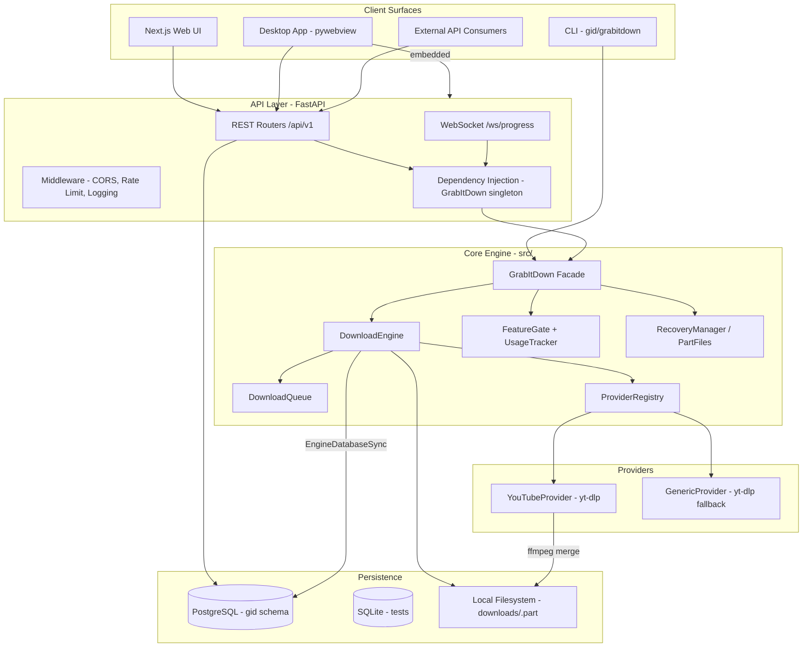

# MediaForge / GrabItDown — Architecture & Capabilities Report

**Prepared for:** Technical architect review  
**Repository:** `d:\Dev\MediaForge`  
**Product version:** 0.1.0  
**Date:** June 13, 2026

---

## 1. Executive Summary

**MediaForge** is the workspace name; the product is branded **GrabItDown** (`grabitdown` on PyPI-style packaging, CLI aliases `gid` / `grabitdown`). It is a **production-oriented media downloader platform** that downloads video and audio from YouTube and other sites (via yt-dlp), with playlist/batch support, transcript extraction, resumable downloads, clip cutting/merging, and tier-based feature gating.

The system is designed as a **multi-surface product**:

| Surface | Role |
|---------|------|
| **Core engine** (`src/`) | Download orchestration, providers, resume, feature gates |
| **REST API** (`api/`) | FastAPI HTTP/WebSocket layer, persistence, multi-tenant schema |
| **CLI** (`src/cli/`) | Rich terminal interface for power users and automation |
| **Desktop app** (`desktop/`) | Native window (pywebview) with embedded API server |
| **Web UI** (`web/`) | Next.js frontend (partially implemented) |

Current operational mode is **"personal mode"** — all API endpoints are accessible without authentication, with the highest tier (`platinum`) enabled by default. Multi-tenant auth, API keys, and tier enforcement are **schema-ready but not yet enforced**.

---

## 2. High-Level Architecture



**Request flow (typical download):**

1. Client submits URL via CLI, API, or desktop dashboard.
2. FastAPI resolves `CurrentUser` (currently a stub "system" user at platinum tier).
3. `GrabItDown.download()` checks feature gate + disk space, resolves provider from URL.
4. `DownloadEngine` queues the job, runs it in a thread pool, tracks progress.
5. `EngineDatabaseSync` writes progress/status to PostgreSQL (throttled ~2s).
6. Completed files land in configured output directory; job metadata persists in DB.

---

## 3. Technology Stack

### Backend (Python 3.11+)

| Category | Technology |
|----------|------------|
| **Framework** | FastAPI 0.115+, Uvicorn |
| **Validation / config** | Pydantic v2, pydantic-settings, PyYAML |
| **Database ORM** | SQLAlchemy 2.0 (async) |
| **DB drivers** | asyncpg (PostgreSQL), aiosqlite (tests) |
| **Migrations** | Alembic (configured; no version files in repo yet) |
| **Media extraction** | **yt-dlp** (YouTube + 1000+ sites via generic provider) |
| **Post-processing** | **FFmpeg/ffprobe** (merge, clip extract, merge) |
| **CLI** | Click + Rich |
| **Real-time** | WebSockets (progress channel scaffolded) |
| **Dev tooling** | pytest, pytest-asyncio, ruff, mypy |

### Frontend (Web)

| Category | Technology |
|----------|------------|
| **Framework** | Next.js 14.2, React 18 |
| **Language** | TypeScript 5 |
| **Styling** | Tailwind CSS 3.4 |
| **State** | Zustand |
| **UI** | Custom shadcn-style components, Lucide icons, Sonner toasts |
| **Testing** | Vitest, Testing Library |

### Desktop

| Category | Technology |
|----------|------------|
| **Shell** | pywebview 4+ (optional extra) |
| **Runtime** | Embedded FastAPI server in background thread |
| **OS integration** | System tray, hotkeys, clipboard monitor, native dialogs, autostart, crash handler, update checker |
| **Packaging** | PyInstaller (`build/build.py`) |

### Infrastructure

| Component | Technology |
|-----------|------------|
| **Database** | PostgreSQL 16 (Docker) |
| **Cache (provisioned)** | Redis 7 (Docker — present in compose, not wired in app code yet) |
| **Containerization** | Docker Compose (`docker/docker-compose.dev.yml`) |

---

## 4. Core Capabilities

### 4.1 Media Download

- **Single URL download** — video or audio, quality selection (360p–2160p, best/worst).
- **Batch download** — multiple URLs in one request.
- **Playlist download** — YouTube playlists with configurable concurrency; sanitized folder naming.
- **Format selection** — list available formats per URL (`/resolve`, CLI `formats`).
- **Metadata extraction** — title, duration, thumbnails, channel info without downloading.
- **Provider auto-detection** — registry picks YouTube vs generic fallback by URL domain.

### 4.2 Transcripts

- **YouTube closed captions** — multi-language, multiple output formats (SRT, VTT, TXT, JSON).
- **Script variants** — roman vs native script support (e.g. Hindi/Urdu).
- **Whisper fallback** — configured in tiers (model size varies by tier); not fully tier-gated in all paths yet.
- **Persistence** — transcripts stored in DB with pagination API.

### 4.3 Clip Processing

- **Clip extraction** — trim video/audio via FFmpeg (`/clips/extract`), fast (keyframe) or precise (re-encode) modes.
- **Clip merge** — combine multiple clips (`/clips/merge`).
- **Validation endpoint** — pre-check clip parameters before extraction.

### 4.4 Download Reliability

- **Resumable downloads** — `.part` files with metadata and progress checkpoints.
- **Integrity checking** — validates partial files before resume.
- **Network monitoring** — detects disconnect/reconnect; optional auto-resume.
- **Retry handler** — exponential backoff, configurable max attempts.
- **State persistence** — saves queued/active jobs on shutdown for recovery.
- **Disk space guard** — blocks downloads when free space below threshold.
- **Bandwidth throttling** — per-download and global limits (tier-gated).

### 4.5 Queue & Job Control

- Priority queue (high / normal / low).
- Pause / resume / cancel individual jobs or entire queue.
- Deferred start (`start=false`) — queue without immediately downloading.
- Concurrent download limit (configurable, tier-capped).
- Real-time progress tracking (percent, speed, ETA, bytes).

### 4.6 Feature Gating & Usage Limits

Tier definitions in `config/feature_flags.yaml`:

| Tier | Price | Highlights |
|------|-------|------------|
| **Basic** | Free | 720p, 5/day, YouTube only, 1 concurrent, 7-day history |
| **Pro** | $9/mo | 1080p, playlists (50), batch (20), 3 concurrent, Whisper small, 30-day history |
| **Platinum** | $24/mo | 4K, unlimited playlists/batch, 5 concurrent, 8 connections, all providers, priority queue |

Currently running in **personal mode** with platinum tier for all requests.

### 4.7 Multi-Tenancy (Schema Ready)

Database models exist for:

- **Tenants** — organizations with tier assignment
- **Users** — email, role, tier override, tenant membership
- **API keys** — hashed keys with permissions and rate limits
- **Download jobs, transcripts, usage tracking** — all tenant-scoped

Auth dependency (`CurrentUser`) is a **skeleton** returning a default system user. JWT/API-key enforcement is planned but not active.

---

## 5. Component Breakdown

### 5.1 Core Engine (`src/`)

```
src/
├── grabitdown.py          # Public facade — wires all subsystems
├── config.py              # YAML + env-based settings (GID_* prefix)
├── core/
│   ├── base_provider.py   # Abstract provider contract
│   ├── provider_registry.py
│   └── provider_factory.py
├── download/
│   ├── download_engine.py # Thread-pool orchestrator
│   ├── queue_manager.py
│   ├── progress_tracker.py
│   ├── chunk_manager.py
│   ├── bandwidth_throttle.py
│   ├── disk_monitor.py
│   └── state_persistence.py
├── providers/
│   ├── youtube/           # YouTubeProvider + playlist helper
│   └── generic/           # yt-dlp catch-all for other sites
├── resume/
│   ├── recovery_manager.py
│   ├── part_file_manager.py
│   ├── integrity_checker.py
│   ├── network_monitor.py
│   └── retry_handler.py
├── features/
│   ├── feature_flags.py
│   ├── feature_gate.py
│   └── usage_tracker.py
├── clip/
│   ├── extractor.py       # FFmpeg clip cutting
│   └── merger.py          # FFmpeg clip merging
├── models/                # Pydantic domain models + enums
└── cli/                   # Full CLI (download, playlist, batch, transcript, etc.)
```

**Design pattern:** Provider plugin architecture — new sites implement `BaseMediaProvider` and register in the factory. Generic provider acts as fallback for any HTTP URL yt-dlp supports.

### 5.2 API Layer (`api/`)

```
api/
├── main.py                # FastAPI app, lifespan, middleware, router mounting
├── config.py              # GID_API_* settings
├── dependencies.py        # GrabItDown singleton, auth skeleton
├── routers/               # 13 router modules
├── services/
│   ├── download_service.py
│   ├── engine_sync.py     # Engine → DB sync
│   ├── progress_bridge.py # Engine → WebSocket (scaffold)
│   └── seed.py            # Default tenant/user seeding
├── database/
│   ├── models.py          # SQLAlchemy ORM (7 tables)
│   └── connection.py      # Async session factory
├── middleware/            # Error handler, rate limiter, request logger
└── schemas/               # Pydantic request/response models
```

**API prefix:** `/api/v1`  
**Docs:** Swagger at `/docs`, ReDoc at `/redoc`

### 5.3 Desktop App (`desktop/`)

Runs as `python -m desktop`:

1. Starts embedded Uvicorn (FastAPI) on configurable host/port.
2. Opens pywebview window loading built-in HTML dashboard (`/dashboard`) or Next.js build if available.
3. Provides OS integrations: system tray, global hotkeys, clipboard URL detection, native file dialogs, notifications, single-instance lock, crash reporting, auto-update checker.

Falls back to browser if pywebview/pythonnet unavailable (common on Python 3.14+).

### 5.4 Web UI (`web/`)

Next.js App Router with pages:

| Route | Status |
|-------|--------|
| `/` | Redirects to `/downloads` |
| `/downloads` | **Not implemented** (nav link exists, no page file) |
| `/history` | Scaffold — placeholder UI |
| `/transcripts` | Form component present |
| `/providers` | Provider listing page |
| `/settings` | Settings page |

Zustand stores exist for downloads and API connection state; frontend is **early-stage** relative to the mature backend.

---

## 6. API Surface Summary

| Router | Prefix | Key Endpoints |
|--------|--------|---------------|
| **Health** | `/health` | Liveness, readiness (DB, ffmpeg, yt-dlp checks), disk usage |
| **Downloads** | `/downloads` | Submit, batch, playlist, pause/resume/cancel, list, download file |
| **Queue** | `/queue` | Stats, pause/resume/clear queue |
| **Resolve** | `/resolve` | URL → provider + metadata |
| **Transcripts** | `/transcripts` | List, extract, languages, get by ID |
| **Clips** | `/clips` | Extract, validate, download result |
| **Clips Merge** | `/clips/merge` | Merge clips, status |
| **Providers** | `/providers` | List registered providers |
| **Features** | `/features` | Current tier, feature matrix, tier comparison |
| **Usage** | `/usage` | Daily usage stats, reset |
| **History** | `/history` | Paginated download history, stats, delete |
| **Config** | `/config` | Get/update app settings |
| **WebSocket** | `/ws/progress` | Real-time progress (connection ready; broadcast wiring incomplete) |

---

## 7. Data Model

PostgreSQL schema `gid` (SQLite in tests):

| Table | Purpose |
|-------|---------|
| `tenants` | Organizations, tier, settings |
| `users` | Accounts, roles, tier overrides |
| `api_keys` | Programmatic access keys |
| `download_jobs` | Full job lifecycle, progress, file paths, parent/child for playlists |
| `transcripts` | Extracted transcript content and metadata |
| `usage_tracking` | Per-user daily counters (downloads, bandwidth) |
| `app_settings` | Key-value configuration store |

Indexes on status, user, tenant, and parent job relationships for query performance.

---

## 8. CLI Commands

Entry points: `gid` or `grabitdown`

| Command | Function |
|---------|----------|
| `download` | Single URL download |
| `playlist` | Playlist download with item selection |
| `batch` | Multiple URLs from args or file |
| `info` | Metadata without download |
| `formats` | List available formats |
| `transcript` | Extract subtitles |
| `providers` | List providers |
| `status` | Active jobs and queue |
| `config` | Show/validate configuration |
| `recovery` | Scan/resume incomplete downloads |
| `features` | Show tier capabilities |
| `check` | System dependency check |
| `resolve` | Detect provider for URL |
| `history` | Download history |

Rich terminal output with progress bars, tables, and formatted sizes/durations.

---

## 9. Configuration

Configuration is layered:

1. **`config/default.yaml`** — base settings (download paths, concurrency, provider toggles, resume behavior).
2. **`config/feature_flags.yaml`** — tier definitions and feature matrix.
3. **Environment variables** — `GID_*` (app), `GID_API_*` (API), `GID_FFMPEG_LOCATION` (FFmpeg path).
4. **`.env`** — loaded from project root regardless of working directory.

Key env vars (from `.env.example`):

- `GID_API_DATABASE_URL` — PostgreSQL or SQLite connection string
- `GID_DOWNLOAD__OUTPUT_DIRECTORY` — download destination
- `GID_FFMPEG_LOCATION` — FFmpeg binary directory (required for video+audio merge on Windows)
- `GID_API_RATE_LIMIT_PER_MINUTE` — API rate limiting

---

## 10. Testing & Quality

| Metric | Value |
|--------|-------|
| **Test files** | 66 Python test modules |
| **Unit tests** | ~60 files covering engine, providers, API, desktop, CLI, models |
| **Integration tests** | YouTube info, download, playlist, provider detection (network-required, marked `@integration`) |
| **Web tests** | Vitest store tests (`web/__tests__/`) |
| **Lint/format** | ruff |
| **Type checking** | mypy (dev dependency) |
| **Verification scripts** | `.verify/` checks, `scripts/api_smoke_test.py`, `scripts/smoke_test.py` |

Test coverage is **strong on the Python core and API**; the Next.js UI has minimal test coverage.

---

## 11. Deployment & Operations

### Development workflow (Makefile targets)

```bash
make install          # pip install -e ".[dev]"
make db-up            # PostgreSQL + Redis via Docker
make db-migrate       # alembic upgrade head
make api-dev          # uvicorn on :8000
make desktop          # native desktop app
make test / test-unit / test-integration
make build-desktop    # PyInstaller packaging
```

### External dependencies

- **FFmpeg/ffprobe** — required for video+audio merge, clip operations, Whisper (future).
- **WebView2 Runtime** — for desktop on Windows.
- **PostgreSQL** — production persistence (SQLite acceptable for dev/test).

### Health/readiness

`/api/v1/health/ready` verifies database connectivity, FFmpeg availability, yt-dlp installation, and disk space — suitable for Kubernetes/orchestrator probes.

---

## 12. Maturity Assessment

### Production-ready areas

- Download engine with queue, concurrency, pause/resume/cancel
- YouTube provider (metadata, formats, download, playlists)
- Generic yt-dlp fallback provider
- Resumable downloads with integrity checks
- Feature flag / tier system (config-driven)
- FastAPI with OpenAPI docs, rate limiting, structured error handling
- Multi-tenant database schema
- Comprehensive unit test suite
- CLI with full command set
- Desktop app with OS integrations

### In progress / gaps

| Area | Status |
|------|--------|
| **Authentication** | Schema exists; enforcement not implemented (personal mode only) |
| **Web UI** | `/downloads` page missing; history/settings are scaffolds |
| **WebSocket progress** | Endpoint exists; bridge broadcast is mostly no-op |
| **Redis** | Provisioned in Docker but not used in application code |
| **Alembic migrations** | Config present; no migration version files in repo |
| **Facebook/Mega/Dropbox providers** | Enum + tier flags exist; not implemented |
| **Whisper transcription** | Tier-configured; integration depth varies |
| **Multi-connection downloads** | Tier flag exists; not clearly implemented in engine |

---

## 13. Architectural Strengths

1. **Clean separation** — Core engine is surface-agnostic; CLI, API, and desktop all consume the same `GrabItDown` facade.
2. **Plugin provider model** — Easy to add site-specific providers without touching the engine.
3. **Tier-based monetization ready** — Feature gate + usage tracker + YAML tier config provide a clear path to SaaS.
4. **Resilience built in** — Part files, network monitor, retry, state persistence, disk guard.
5. **Dual persistence strategy** — In-memory engine for performance + async DB sync for durability.
6. **Multiple deployment surfaces** — Same backend powers API-only, desktop, CLI, and future web SaaS.

---

## 14. Recommended Architect Discussion Points

1. **Auth strategy** — JWT vs API keys vs OAuth; when to enforce vs keep personal mode.
2. **Web UI completion** — Priority for `/downloads` with WebSocket progress vs desktop-first.
3. **Redis role** — Job queue offload, rate limiting, WebSocket pub/sub, or session store.
4. **Migration strategy** — Alembic baseline migration needed before production DB deploys.
5. **Horizontal scaling** — Current engine is in-process singleton; scaling requires job queue (Celery/RQ/Redis) and shared storage.
6. **Naming alignment** — MediaForge (repo) vs GrabItDown (product) — clarify for stakeholders.
7. **Compliance** — Media downloading has legal/ToS implications per provider; architecture should document allowed use cases.

---

## 15. Repository Structure (Top Level)

```
MediaForge/
├── api/           # FastAPI REST + WebSocket API
├── src/           # Core download engine, providers, CLI
├── desktop/       # Native desktop application
├── web/           # Next.js frontend
├── config/        # YAML configuration + feature flags
├── docker/        # PostgreSQL + Redis compose
├── tests/         # Unit + integration tests
├── scripts/       # Smoke tests, demos
├── requirements/  # pip requirements (base, dev)
├── pyproject.toml # Package definition (name: grabitdown)
└── Makefile       # Dev workflow commands
```

---

This report reflects the codebase as it exists today. The backend and engine are substantially complete for a v0.1 media downloader platform; the primary gaps are authentication enforcement, web UI completion, and production infrastructure wiring (migrations, Redis, WebSocket broadcast).
