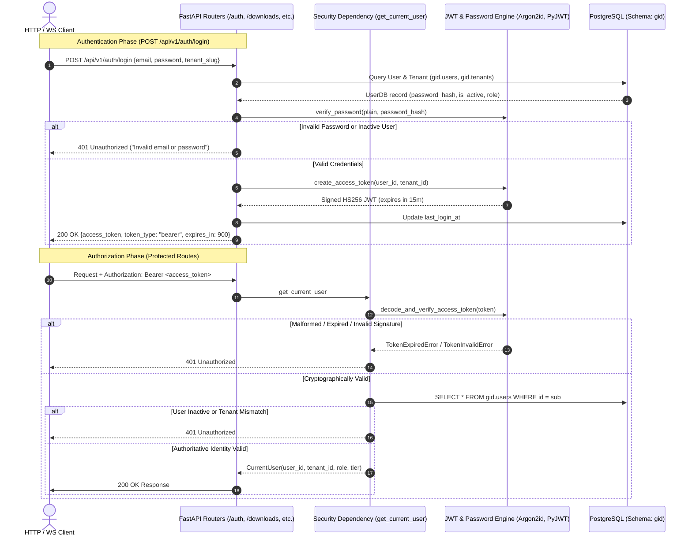
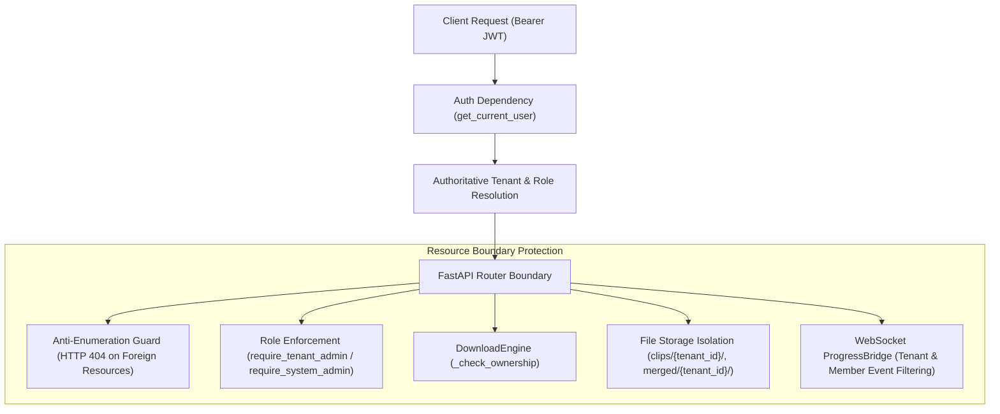
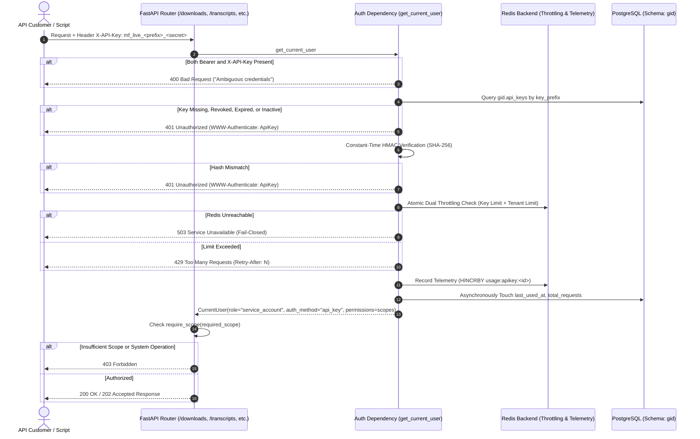

# MediaForge API Security Architecture

## 1. Executive Summary & Security Posture

MediaForge is transitioning from a single-user local tool into a commercial multi-tenant SaaS platform and desktop suite.
- **STEP 02-A:** Established a **deny-by-default, fail-closed security boundary** across all HTTP and WebSocket routes, eliminating implicit bypasses and public diagnostic exposures.
- **STEP 02-B1:** Established the **cryptographic JWT access-token foundation**, Argon2id password hashing, authoritative PostgreSQL identity/tenant resolution, and login/identity endpoints (`/api/v1/auth/login`, `/api/v1/auth/me`).

### Core Tenets
1. **Deny by Default:** No endpoint is accessible anonymously unless it is explicitly and purposefully allowlisted as a public probe or public documentation asset.
2. **Fail-Closed Operation:** Missing, malformed, expired, or unverified credentials strictly fail closed with `HTTP 401 Unauthorized` and `WWW-Authenticate: Bearer`.
3. **No Header Trust:** Client-provided identity headers (such as `X-User-ID`, `X-Tenant-ID`, or `X-User-Role`) are never trusted and cannot bypass authentication.
4. **Authoritative Database Resolution:** Token claims (e.g., `role`, `tier`) are never trusted unconditionally. Tenant membership, account active status, role, and tier are resolved directly from authoritative database records in schema `gid`.
5. **Strict Multi-Tenant Isolation:** All database queries, cached state, and file artifacts must be isolated by `tenant_id`. No tenant (including `"default"`) may inspect another tenant's resources.
6. **Separation of Transports:** Standalone CLI and background worker execution remain unaffected by HTTP security constraints, while FastAPI strictly protects the network boundary.

---

## 2. Authentication Flow



---

## 3. Password Hashing Specification (Argon2id)

Module: [`api/security/passwords.py`](file:///D:/Dev/MediaForge/api/security/passwords.py)

- **Algorithm:** Argon2id (RFC 9106 recommended).
- **Parameters:**
  - Time cost ($t$): 3 iterations
  - Memory cost ($m$): 65,536 KiB (64 MiB)
  - Parallelism ($p$): 4 threads
  - Salt length: 16 bytes (cryptographically generated per hash)
  - Hash length: 32 bytes
- **Boundaries:**
  - Minimum password length: 8 characters
  - Maximum password length: 128 characters (mitigating denial-of-service via computationally heavy hashing of arbitrarily large inputs)
- **Rehashing:** `check_needs_rehash(hash)` automatically identifies outdated parameters and triggers a rehash upon successful login.
- **Zero Logging:** Plaintext passwords are never logged, printed, or persisted.

---

## 4. JWT Access Token Specification

Module: [`api/security/jwt.py`](file:///D:/Dev/MediaForge/api/security/jwt.py)

- **Algorithm:** Explicit `HS256` (HMAC with SHA-256). Tokens using `alg: "none"` or unpermitted algorithms are strictly rejected.
- **Lifetime:** Short-lived access token: 15 minutes (`900` seconds).
- **Signing Key:** Loaded from `GID_JWT_SECRET_KEY` in `.env` (git-ignored). Enforces minimum 32 characters.
- **Standard Claims:**
  - `sub`: User UUID string (authoritative subject)
  - `tid`: Tenant UUID string (authoritative tenant)
  - `iss`: Issuer (`"mediaforge"`)
  - `aud`: Audience (`"mediaforge-api"`)
  - `iat`: Issue timestamp (UTC epoch seconds)
  - `nbf`: Not before timestamp (UTC epoch seconds)
  - `exp`: Expiration timestamp (UTC epoch seconds)
  - `jti`: Unique token identifier (UUIDv4)
  - `typ`: Token type (`"access"`)
- **Verification Rules:**
  - Must pass cryptographic HMAC signature verification.
  - Must not be expired (`exp > now`).
  - Must match configured issuer and audience.
  - Must have `typ == "access"`.

---

## 5. Authoritative Identity & Tenant Resolution

Authentication does **not** trust client claims inside the token body. When an access token is presented:
1. The subject `sub` and tenant `tid` are extracted from the verified payload.
2. The user record is queried from PostgreSQL (`gid.users`).
3. If the user does not exist or `is_active is False`, access is denied (`401`).
4. If `user.tenant_id != tid`, access is denied (`401`).
5. The tenant record is queried from PostgreSQL (`gid.tenants`). If `tenant.is_active is False`, access is denied (`401`).
6. The user's role is taken directly from `user.role` (database), preventing privilege escalation via forged token claims.
7. The user's tier is taken directly from `user.tier_override` or `tenant.tier`.

---

## 6. Authentication Endpoints

### 1. `POST /api/v1/auth/login`
- **Request:**
  ```json
  {
    "email": "user@example.com",
    "password": "Password123!",
    "tenant_slug": "default"
  }
  ```
- **Response (200 OK):**
  ```json
  {
    "access_token": "eyJhbGciOi...",
    "token_type": "bearer",
    "expires_in": 900
  }
  ```
- **Failure:** Returns generic `401 Unauthorized` (`{"detail": "Invalid email or password"}`) on wrong password, inactive user, non-existent tenant, or non-existent user (preventing user enumeration).

### 2. `GET /api/v1/auth/me`
- **Headers:** `Authorization: Bearer <token>`
- **Response (200 OK):**
  ```json
  {
    "user_id": "00000000-0000-0000-0000-000000000002",
    "tenant_id": "00000000-0000-0000-0000-000000000001",
    "email": "system@grabitdown.local",
    "display_name": "System User",
    "role": "owner",
    "tier": "platinum",
    "auth_method": "jwt"
  }
  ```
- **Safety Guarantee:** Excludes password hashes, signing keys, and internal secrets.

---

## 7. Safe Account Provisioning

No default administrator passwords exist. Test accounts are provisioned explicitly using:

### CLI Provisioning
```powershell
# Set password securely (prompts without echo)
python -m api.services.manage_user set-password --email system@grabitdown.local --tenant default

# Or with PowerShell helper
.\deploy\scripts\Set-UserPassword.ps1 -Email "system@grabitdown.local"
```

### Safety Guarantees
- Uses least-privilege runtime role (`gid_app`).
- Only updates existing authorized accounts; refuses to create arbitrary accounts.
- Enforces minimum 8-character length and Argon2id hashing.
- Plaintext password is never printed or logged.

---

## 8. WebSocket Security Architecture

FastAPI WebSocket route: `/api/v1/ws/progress`

1. **Avoidance of Query Parameter Tokens:** Query string tokens (`ws://host/path?token=...`) are discouraged as they leak into proxy logs and browser history.
2. **In-Band Authentication (Preferred):** Clients connect and send an initial authentication frame within a 2-second timeout window:
   ```json
   {
     "type": "auth",
     "token": "<access_token>"
   }
   ```
3. **Database Validation:** The token is validated using `resolve_principal_from_token` against the authoritative PostgreSQL database.
4. **Fail-Closed Violation:** Any unauthenticated or invalid connection is terminated immediately with RFC 6455 status code `1008` (Policy Violation) and reason `"Authentication required"`.

---

## 9. Self-Service Tenant Registration and Email Verification (STEP 02-B2A)

MediaForge provides secure, anti-enumeration, staged self-service tenant registration with transactional email verification via Mailpit.

### 1. Staged Registration Architecture
- **No Premature Entity Creation:** Unverified registrations are held in `gid.pending_registrations`. Permanent `TenantDB` and `UserDB` entities are never created until email verification completes.
- **Argon2id Hash Staging:** Password hashes are computed upon initial registration using Argon2id and stored in `pending_registrations.password_hash`. Raw passwords are never retained.
- **Cryptographic Token Hashing:** A 32-byte cryptographically secure random token (`secrets.token_urlsafe(32)`) is generated. Only the SHA-256 hash (`token_hash`) is persisted in PostgreSQL.
- **Token Lifecycle:** Tokens expire strictly after 24 hours (`expires_at`).
- **Single-Use Activation:** Upon successful verification, permanent tenant and owner entities are created within a single atomic database transaction, and the pending record is immediately purged.
- **Least-Privilege Tier Assignment:** Self-registered tenants are strictly created with tier `"basic"`. The `"platinum"` tier is reserved for system/administrative provisioning.
- **Initial Role Assignment:** The registered user is granted the `"owner"` role for their newly created tenant.
- **Anti-Enumeration Protection:** If a registration request is submitted for an existing email, the API returns `202 Accepted` with a generic message without leaking account existence or dispatching tokens.

### 2. Endpoints
- `POST /api/v1/auth/register` (Status: `202 Accepted`): Initiates registration, enforces password complexity (8-128 chars, upper, lower, digit, special), rate limits requests, and dispatches verification email.
- `POST /api/v1/auth/verify-email` (Status: `200 OK`): Verifies SHA-256 token hash, atomically provisions tenant and user, and removes staged record.
- `POST /api/v1/auth/resend-verification` (Status: `200 OK`): Refreshes token and dispatches new email, enforcing a 60-second cooldown period.

### 3. Abuse Prevention & Fail-Closed Rate Limiting
Module: [`api/services/rate_limiter.py`](file:///D:/Dev/MediaForge/api/services/rate_limiter.py)
- **Redis Backend:** Redis (`redis:6379`) tracks sliding fixed-window counters and cooldown intervals.
- **Fail-Closed Security Policy:** If Redis is unreachable or fails, public sensitive endpoints (`/register`, `/resend-verification`, `/login`) strictly **fail closed** with `HTTP 503 Service Unavailable`, preventing credential stuffing and brute-force attacks during Redis outages.
- **Throttling Thresholds:**
  - Registration by IP: 5 attempts / minute (`HTTP 429 Too Many Requests`).
  - Registration by Email: 3 attempts / hour per normalized email.
  - Verification Resend Cooldown: 60-second cooldown per email with `Retry-After` header.
  - Login by IP: 10 attempts / minute.
  - Login by Email: 10 attempts / 15 minutes.
- **PII Protection:** Email addresses are hashed with SHA-256 before being embedded in Redis rate-limit keys (`rl:login:email:<sha256>`).
- **Concurrent Single-Use Registration:** Token verification serializes concurrent attempts using PostgreSQL row locks (`with_for_update()`), ensuring duplicate requests cannot create multiple tenants or users.

---

## 10. Persistent Sessions, Rotating Refresh Tokens, and Immediate Revocation (STEP 02-B2B)

### 1. Data Models (`schema: gid`)
- **`gid.auth_sessions`**:
  - `id` (UUIDv4): Primary session identifier bound into the `sid` claim of all access tokens.
  - `user_id` / `tenant_id` (UUIDv4): Foreign keys to `gid.users` and `gid.tenants` (with `ON DELETE CASCADE`).
  - `current_token_hash` (VARCHAR(64), UNIQUE): SHA-256 hash of the currently valid refresh token.
  - `user_agent`, `ip_address`: Client telemetry for anomaly detection.
  - `is_revoked` (BOOLEAN): Revocation status flag.
  - `revoked_at` (TIMESTAMP): UTC timestamp when session was revoked.
  - `revocation_reason` (VARCHAR(64)): Revocation trigger (`"logout"`, `"logout_all"`, `"replay_attack"`, etc.).
  - `expires_at` (TIMESTAMP): Absolute session expiration timestamp (default: 30 days).
- **`gid.consumed_refresh_tokens`**:
  - `id` (UUIDv4): Record identifier.
  - `session_id` (UUIDv4): Foreign key to parent `gid.auth_sessions`.
  - `token_hash` (VARCHAR(64), UNIQUE): SHA-256 hash of a retired refresh token.
  - `consumed_at` (TIMESTAMP): UTC timestamp when token was rotated.
  - `expires_at` (TIMESTAMP): UTC timestamp when the token would have expired (for pruning).

### 2. Opaque Refresh Token Lifecycle
- **Entropy & Cryptography:** Refresh tokens are high-entropy opaque strings generated via `secrets.token_urlsafe(48)` ($\ge 256$ bits of entropy).
- **Hash-Only Storage:** Raw refresh tokens are never persisted. Only their SHA-256 digests are stored in `gid.auth_sessions.current_token_hash` and `gid.consumed_refresh_tokens.token_hash`.
- **Atomic Single-Use Rotation:**
  - Upon calling `POST /api/v1/auth/refresh`, the session row is locked via PostgreSQL `SELECT ... FOR UPDATE`.
  - The presenting token's SHA-256 hash is checked against `current_token_hash`.
  - The previous token is recorded in `gid.consumed_refresh_tokens`.
  - A brand-new refresh token and access token are issued, and `current_token_hash` is atomically updated.
- **Replay Detection & Family Revocation:**
  - If a submitted refresh token hash matches a record in `gid.consumed_refresh_tokens`, a **token reuse / replay attack** is detected.
  - The entire session family is immediately revoked (`is_revoked = True`, `revocation_reason = "replay_attack"`).
  - The endpoint responds with `HTTP 401 Unauthorized` (`"Invalid refresh token. Token reuse detected and session revoked."`).
  - Any subsequent requests presenting either the old or newly rotated token will fail.

### 3. Immediate Access Token Invalidation on Logout
- **Binding Claim:** Every issued access token embeds an `"sid"` claim referencing its parent `auth_sessions.id`.
- **Authoritative Session Verification:** During `resolve_principal_from_token` ([`api/dependencies.py`](file:///D:/Dev/MediaForge/api/dependencies.py)), the database checks that the referenced session exists, is not revoked (`is_revoked == False`), and is unexpired (`expires_at > now`).
- **Zero-Delay Revocation:** When a session is revoked via `POST /api/v1/auth/logout` or replay detection, any active access tokens bound to that session become **immediately invalid** on the very next HTTP request without waiting for the 15-minute JWT lifetime to expire.

### 4. Endpoints
- `POST /api/v1/auth/login`:
  - Body: `{ email, password, tenant_slug? }`
  - Response: `{ access_token, refresh_token, session_id, token_type: "bearer", expires_in: 900 }`
  - Enforces IP and email rate limits with fail-closed behavior.
- `POST /api/v1/auth/refresh`:
  - Body: `{ refresh_token }`
  - Response: `{ access_token, refresh_token, session_id, token_type: "bearer", expires_in: 900 }`
  - Rotates refresh token and issues new JWT while maintaining session continuity.
- `POST /api/v1/auth/logout`:
  - Requires: Bearer access token OR `{ refresh_token }` in body.
  - Optional flag: `?all_sessions=true` to invalidate all active sessions for the authenticated user.
  - Response: `200 OK` `{ message: "Successfully logged out.", session_id }`

### 5. Client Token Storage Guidance
- **Web Applications:** Store refresh tokens in `HttpOnly`, `Secure`, `SameSite=Lax` (or `Strict`) cookies. Keep short-lived access tokens in memory (JavaScript runtime state) to protect against XSS token exfiltration.
- **Desktop & Native Clients (Electron / CLI):** Store refresh tokens using OS-level secure storage primitives (e.g., Windows DPAPI / Credential Manager, macOS Keychain, Linux Secret Service / libsecret). Avoid saving refresh tokens in plaintext configuration files or unencrypted `localStorage`.

---

## 11. Secure Password Recovery, Reset, and Password Change (STEP 02-B2C)

MediaForge enforces zero-trust, anti-enumeration password recovery and authenticated credential updates with atomic, whole-account session invalidation.

### 1. Data Model (`schema: gid`)
- **`gid.password_reset_tokens`**:
  - `id` (UUIDv4): Primary key.
  - `user_id` (UUIDv4): Foreign key referencing `gid.users.id` with `ON DELETE CASCADE`.
  - `token_hash` (VARCHAR(128), UNIQUE, INDEX): SHA-256 hash of the raw recovery token.
  - `created_at` (TIMESTAMP): UTC creation timestamp.
  - `expires_at` (TIMESTAMP, INDEX): Expiration timestamp (default: 30 minutes).
  - `consumed_at` (TIMESTAMP, nullable): Redemption timestamp. Once set, the token is permanently spent.
  - `client_ip` (VARCHAR(45), nullable): Request client IP for audit logging.
  - `user_agent` (VARCHAR(500), nullable): Request User-Agent for audit telemetry.

### 2. Password Recovery Request (`POST /api/v1/auth/forgot-password`)
- **Anti-Enumeration Protection:** The endpoint accepts a normalized email and always responds with `200 OK` and a generic response:
  `"If the account exists and is eligible, a password reset link has been sent to your email."`
  The response timing and payload are indistinguishable whether the account exists, does not exist, is inactive, or is a reserved identity.
- **Reserved Internal Identity Protection:** Accounts identified as system/administrative infrastructure (`system@grabitdown.local`, `system@mediaforge.local`, or `user.role == 'system'`) are completely blocked from public recovery. No tokens are generated and no emails are dispatched.
- **Token Generation & Cryptography:** A 32-byte URL-safe cryptographic token is generated (`secrets.token_urlsafe(32)`, $\ge 256$ bits of entropy). Only its SHA-256 digest is persisted.
- **Token Invalidation:** Requesting a new recovery token automatically marks any outstanding unconsumed recovery tokens for that user as consumed.
- **Fail-Closed Throttling:** Throttled per IP (5 requests/minute) and per email (3 requests/hour). When Redis rate limiting is offline, public recovery requests strictly fail closed with `HTTP 503 Service Unavailable`.
- **Zero Premature Disruption:** Requesting recovery does not reset passwords, disable accounts, or terminate active sessions.

### 3. Password Reset (`POST /api/v1/auth/reset-password`)
- **Single-Use Redemption with Row Locking:** When a recovery token is presented, the token row is locked via `SELECT ... FOR UPDATE`.
- **Atomic Transaction Integrity:**
  - Token is verified to be unconsumed (`consumed_at is None`) and unexpired (`expires_at > now`).
  - User password hash is updated to a newly computed Argon2id hash.
  - The redemption token is stamped as consumed (`consumed_at = now`).
  - Any other outstanding reset tokens for the user are invalidated.
  - All existing user sessions in `gid.auth_sessions` are revoked (`is_revoked = True`, `revocation_reason = "password_reset"`).
  - All changes succeed or roll back together atomically.
- **Concurrency Protection:** Concurrent attempts to redeem the same recovery token are serialized; exactly one request succeeds and all others fail with `HTTP 400 Bad Request`.
- **No Automatic Access:** Resetting a password never auto-logs in the user. The user must perform a fresh login.

### 4. Authenticated Password Change (`POST /api/v1/auth/change-password`)
- **Strict Authentication & Verification:** Requires a valid, unrevoked JWT access token. The request must supply the current password and a new password conforming to complexity rules.
- **IDOR Protection:** The user ID is strictly extracted from the verified `CurrentUser` principal. Clients cannot supply an arbitrary user ID.
- **Credential Verification:** Current password must verify against the user's stored Argon2id hash. Incorrect passwords fail with `HTTP 401 Unauthorized`.
- **Atomic Invalidation:** Upon updating to the new Argon2id password hash, all active sessions (including the session used to submit the change) are immediately revoked with `revocation_reason = "password_change"`.
- **Mandatory Re-Login:** The active access token is rejected on the very next request; the user must re-authenticate with their new password.

### 5. Email Delivery & Mailpit Integration
- Delivery is handled via [`api/services/email_service.py`](file:///D:/Dev/MediaForge/api/services/email_service.py) connecting to Mailpit SMTP (`mailpit:1025`).
- The transactional email includes clear reset instructions, token expiration, guidance to ignore unrequested resets, and product branding.
- Recovery tokens are never printed or logged in application logs or server transcripts.

---

## 12. Enterprise Tenant Isolation and Role-Based Authorization (STEP 02-C1)

MediaForge enforces defense-in-depth tenant boundary enforcement across HTTP APIs, file storage, database entities, background engines, and WebSocket streams.

### 1. Authorization Role Hierarchy

| Role | Scope | Permissions & Boundary Rules |
| :--- | :--- | :--- |
| `owner` | Single Tenant | Highest authority within their own tenant. Manages tenant users, views tenant-wide jobs/history, resets tenant usage. **Strictly prohibited** from accessing foreign tenant resources or global system administration. |
| `admin` | Single Tenant | Administrative actions within their own tenant. Can view all jobs/history for their tenant and reset tenant member usage. **Strictly prohibited** from accessing foreign tenant resources or global system administration. |
| `member` | Single Tenant (Intracompany Scoped) | Regular user within a tenant. Enforces **intracompany isolation**: can only view, control, and download their own jobs, files, history records, and WebSocket progress events. Forbidden from administrative tasks. |
| `system_admin` | Platform Global | Global platform operations only. Strictly required for engine runtime reconfiguration (`PUT /api/v1/config`) and global queue pause/resume (`POST /api/v1/queue/pause`, `POST /api/v1/queue/resume`). Cannot be spoofed via client request parameters. |

### 2. Multi-Layer Tenant Isolation Matrix



### 3. Layer-by-Layer Boundary Enforcement

1. **Anti-Enumeration Protection (HTTP 404):**
   - Querying or manipulating nonexistent or foreign-tenant resources (downloads, files, transcripts, usage, clips, merged media) returns `HTTP 404 Not Found` rather than `403 Forbidden`.
   - Prevents unauthorized adversaries from discovering the existence or identifiers of other tenants' assets.

2. **Download Engine & In-Memory Jobs:**
   - Methods `get_job`, `get_all_jobs`, `cancel_job`, `pause_job`, `requeue_job`, `move_job_up`, `move_job_down`, and `start_all_deferred` in [`src/download/download_engine.py`](file:///D:/Dev/MediaForge/src/download/download_engine.py) strictly accept `tenant_id` and optional `user_id`.
   - `_check_ownership(job, tenant_id, user_id)` verifies that jobs belong to the caller's tenant (and user for members) before returning details or executing transitions.
   - Any attempt to access a job belonging to another tenant returns `None` (resulting in `HTTP 404` at the HTTP layer).

3. **File Artifact System Storage:**
   - Downloaded media files are verified against the authoritative job tenant and user before streaming via `GET /api/v1/downloads/{job_id}/file`.
   - Video clips are isolated in dedicated subdirectories per tenant: `data/clips/{tenant_id}/`.
   - Merged video outputs are isolated in dedicated subdirectories per tenant: `data/merged/{tenant_id}/`.
   - Directory traversal (`../`) and cross-tenant file downloads are strictly rejected with `HTTP 404`.

4. **Transcripts & History Service:**
   - Transcripts in `gid.transcripts` require strict tenant match (`transcript.tenant_id == user.tenant_id`). Mismatches return `HTTP 404`.
   - History queries and deletion in `gid.history` scope automatically:
     - Members only view and clear history rows where `user_id == caller.user_id` and `tenant_id == caller.tenant_id`.
     - Admins/owners view and clear history across their entire tenant.

5. **Real-Time WebSocket Stream Isolation:**
   - WebSocket clients authenticate during handshake (`/api/v1/ws/progress?token=<jwt>`).
   - [`ProgressBridge`](file:///D:/Dev/MediaForge/api/services/progress_bridge.py) tracks `tenant_id` and `user_id` for each connected client.
   - Job progress events dispatched from the engine are filtered:
     - Event `job.tenant_id` must match client `tenant_id`.
     - For member clients, event `job.user_id` must match client `user_id`.
   - Cross-tenant broadcast leakage is completely eliminated.

6. **Centralized Reusable Dependencies:**
   - `require_role(allowed_roles)`: Factory checking caller role against allowed list.
   - `require_tenant_admin()`: Restricts endpoint to tenant admins and owners (`["admin", "owner", "system", "system_admin"]`).
   - `require_system_admin()`: Restricts endpoint exclusively to global platform administrators (`["system", "system_admin"]`).
   - `TenantContext`: Context object derived from `CurrentUser` to enforce tenant boundaries without trusting request headers.

---

---

## 13. Commercial API Keys & Scoped Authorization (STEP 02-C2)

### 1. Architecture & Design Principles

Commercial API keys enable programmatic, machine-to-machine integrations for third-party MediaForge customers and automated pipelines while preserving strict multi-tenant isolation, granular least-privilege scoping, and fail-closed operational safety.



### 2. Cryptographic Token Design & Storage Security

Module: [`api/security/api_keys.py`](file:///D:/Dev/MediaForge/api/security/api_keys.py)

- **Format:** `mf_live_<prefix>_<secret>`
  - Environment identifier: `mf_live_`
  - High-selectivity prefix: 8 alphanumeric characters generated via `secrets.token_urlsafe`
  - High-entropy secret token: 32 bytes of cryptographically secure random bytes ($\ge 256$ bits of entropy) encoded as URL-safe Base64
- **Single-Exposure Guarantee:** The raw plaintext key is generated in memory, returned strictly once upon creation or rotation, and **never saved or retrievable again**.
- **Cryptographic Storage:**
  - Plaintext keys are never stored in the database.
  - The secret is hashed using `SHA-256` (`api.security.api_keys.hash_api_key`) and stored in `gid.api_keys.key_hash`.
  - Prefix is indexed (`gid.api_keys.key_prefix`) with a unique constraint to avoid full-table scans.
  - Verification uses constant-time string comparison (`hmac.compare_digest`) to protect against timing analysis attacks.
- **Masking:** All list, detail, and audit endpoints display only masked representations: `mf_live_<prefix>...****`.

### 3. Key Lifecycle & Administrative Boundaries

Module: [`api/routers/api_keys.py`](file:///D:/Dev/MediaForge/api/routers/api_keys.py), [`api/services/api_key_service.py`](file:///D:/Dev/MediaForge/api/services/api_key_service.py)

| Endpoint | Method | Role Required | Description |
| :--- | :--- | :--- | :--- |
| `/api/v1/api-keys` | `POST` | Tenant Owner / Admin | Creates a new key with specified scopes, rate limit, and optional expiration. Returns raw secret key exactly once (`HTTP 201`). |
| `/api/v1/api-keys` | `GET` | Tenant Owner / Admin | Lists active and historical API keys for caller's tenant with masked secrets. |
| `/api/v1/api-keys/{id}` | `GET` | Tenant Owner / Admin | Inspects single key metadata with anti-enumeration protection (returns `HTTP 404` on foreign keys). |
| `/api/v1/api-keys/{id}` | `DELETE` | Tenant Owner / Admin | Immediately revokes an API key. Rejection is instantaneous across all routes (`HTTP 401`). |
| `/api/v1/api-keys/{id}/rotate` | `POST` | Tenant Owner / Admin | Atomically revokes an existing key and provisions a replacement with the same scopes, returning new secret once (`HTTP 201`). Supports optional overlap minutes. |

#### Administrative Isolation Invariants:
1. **User Session Only:** API keys cannot access `/api/v1/api-keys` endpoints to create, inspect, rotate, or revoke keys (`_assert_user_session_only` returns `HTTP 403 Forbidden`).
2. **Member Prohibition:** Regular tenant members (`role="member"`) cannot manage API keys (`HTTP 403 Forbidden`).
3. **System Operation Deny:** API keys are strictly forbidden from executing administrative or system-level endpoints (`GET /api/v1/config`, `PUT /api/v1/config`, `POST /api/v1/queue/pause`, `POST /api/v1/queue/resume`, user management, and tier overrides).

### 4. Granular Permission Scopes

Supported Scopes:
- `downloads:read`: List downloads, get download status, download completed files, read download history.
- `downloads:write`: Submit single, batch, or playlist downloads; pause, resume, cancel downloads; clear history.
- `clips:read`: Validate timestamps, download extracted clips and merged files.
- `clips:write`: Extract video clips, merge multiple video clips.
- `transcripts:read`: List transcripts, list available transcript languages, retrieve saved transcript text.
- `transcripts:write`: Extract on-demand transcripts from video URLs.
- `usage:read`: Inspect current tenant and key usage quotas.
- `providers:read`: List available media extractors and capabilities.

Scope verification is enforced at the router boundary using the dependency factory:
```python
user: CurrentUser = Depends(require_scope("downloads:write"))
```
For user sessions (Bearer JWT), `require_scope` passes through to RBAC. For service accounts (API keys), it asserts that the required scope is explicitly present in `user.permissions` or `*` is granted.

### 5. Redis-Backed Dual Rate Limiting & Telemetry

Module: [`api/services/rate_limiter.py`](file:///D:/Dev/MediaForge/api/services/rate_limiter.py)

Dual-layer throttling protects system stability and tenant equity:
1. **Individual Key Rate Limit:** Default 60 req/min (configurable up to 1,000 req/min per key). Tracked in Redis key `rl:apikey:<key_id>`.
2. **Tenant Aggregate Rate Limit:** 300 req/min across all API keys belonging to the tenant. Tracked in Redis key `rl:tenant_api:<tenant_id>`.
3. **Atomic Evaluation:** Both counters and their TTLs are incremented atomically via a Redis pipeline transaction.
4. **Fail-Closed Security:** If the Redis cluster or sentinel is unreachable, API key requests fail closed with `HTTP 503 Service Unavailable`, preventing unmetered denial-of-service abuse.
5. **Usage Telemetry:** Request counters and timestamp metrics are recorded in Redis hash `usage:apikey:<key_id>` asynchronously without inducing database write contention.

---

## 14. Remaining Account Lifecycle Roadmap (STEP 02-C+)

1. **Session Management UI & Diagnostics:** User-facing active session inspection (device, IP, last active) and remote session termination.
2. **MFA / TOTP:** Two-factor authentication with authenticator apps and backup codes.
