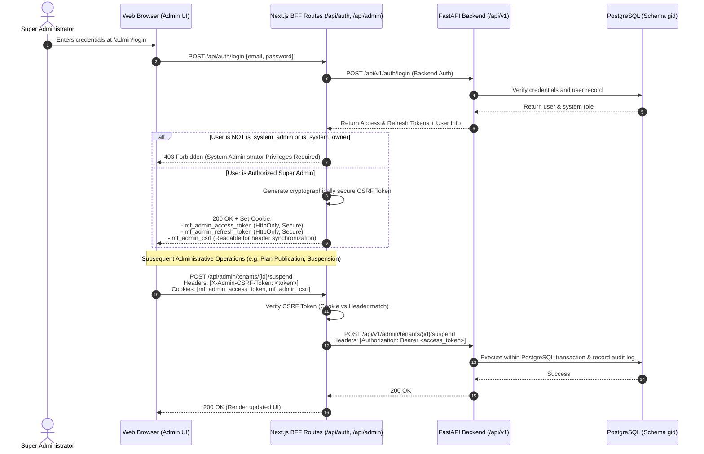
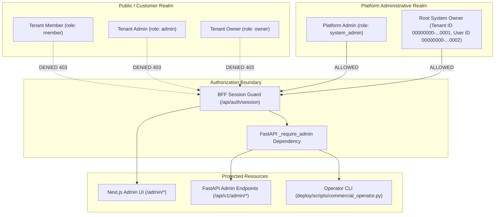
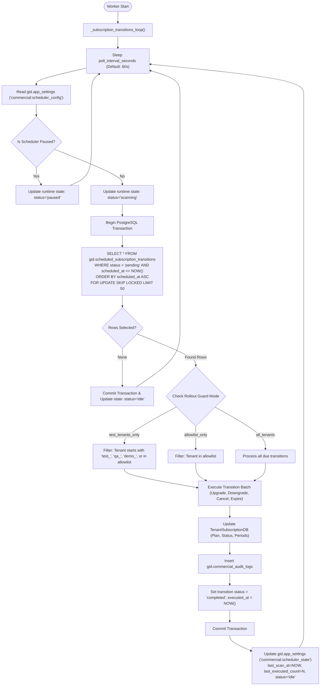
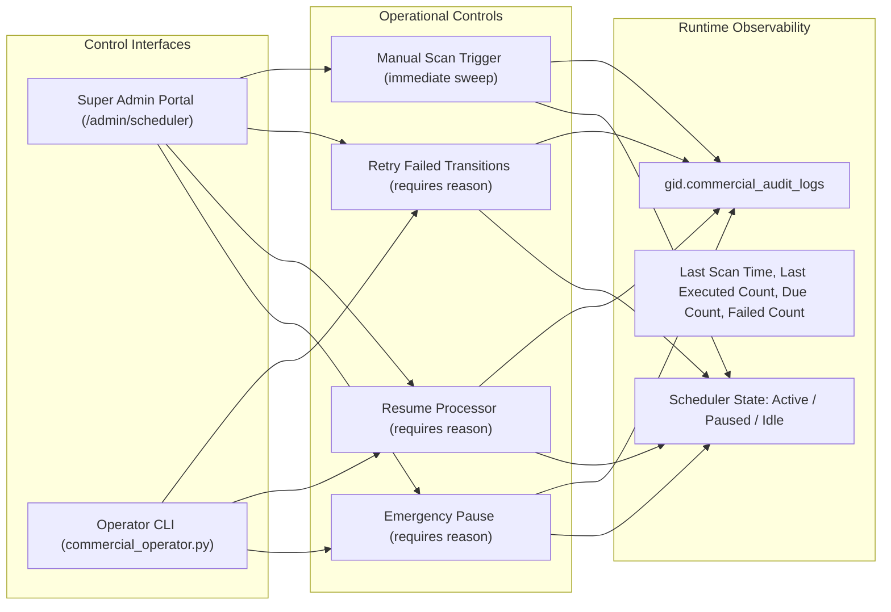

# MediaForge — Commercial Administration, Super Admin Portal and Subscription Operations

This architectural document defines the production design, security boundaries, authentication mechanisms, web user interface architecture, automated background processing loops, and operator controls for the MediaForge Commercial Administration Platform as finalized in **STEP 04-B1** and accepted across real browser automation in **STEP 04-B2-A** and **STEP 04-B2-B**.

For the local containerized staging rehearsal report and performance benchmarks, see [LOCAL_STAGING_REHEARSAL_REPORT.md](file:///D:/Dev/MediaForge/docs/architecture/LOCAL_STAGING_REHEARSAL_REPORT.md).

---

## 1. Executive Summary & Design Mission

The MediaForge Commercial Administration Platform transforms the subscription lifecycle backend developed in STEP 04-A3 into an enterprise-grade, secure, and operationally resilient management system.

### Core Architectural Pillars

1. **Backend-for-Frontend (BFF) Security Isolation**: All administrative web traffic terminates at Next.js 15 server route handlers (`next@15.5.28`, security-patched for CVE-2025-29927). Authentication tokens (`mf_admin_access_token`, `mf_admin_refresh_token`) are strictly stored in `HttpOnly`, `SameSite=Lax`, `Secure` cookies. No JWTs or sensitive bearer credentials are ever accessible to client JavaScript or localStorage.
2. **Cryptographic HMAC-SHA256 Session-Bound Anti-CSRF & Origin Protection**: All mutating administrative actions (`POST`, `PUT`, `DELETE`, `PATCH`) require both an anti-CSRF cookie (`mf_admin_csrf`) and an identical custom header (`X-Admin-CSRF-Token` / `X-CSRF-Token`). Tokens are cryptographically bound to both the authenticated user ID and backend session ID (`sid`), signed via HMAC-SHA256 with constant-time `crypto.timingSafeEqual` validation. Origin and Referer headers are strictly checked against the server Host header, request bodies are bounded to 1MB, and dynamic route proxies enforce `Cache-Control: private, no-store`.
3. **Strict RBAC Fencing**: Complete isolation between tenant-scoped users (even tenant `owner` or `admin`) and system-level platform super administrators (`is_system_admin` or `is_system_owner`). Ordinary tenant owners cannot access `/admin/*` or administrative backend endpoints under `/api/v1/admin/*`. Non-admin authentication attempts reject with HTTP 403.
4. **Durable, Row-Locked Background Automation**: The MediaWorker executes a background recurring loop every 60 seconds using PostgreSQL `FOR UPDATE SKIP LOCKED` on `gid.scheduled_subscription_transitions`, ensuring single-worker execution across multiple worker replicas without race conditions.
5. **Strict Server-Authoritative Allowlist Rollout Guard**: Automated background transition sweeps enforce an authoritative allowlist rollout guard mode (`allowlist_only` by default) that strictly restricts automated execution to explicit tenant IDs registered in `tenant_allowlist`. In `all_tenants` mode, grandfathered `legacy_active` accounts are automatically fenced from automated mutation.
6. **Zero Disruption for Reconciled Accounts**: All 481 reconciled customer baseline accounts (459 active and 22 grandfathered `legacy_active`) remain intact and undisturbed. Global quota enforcement remains disabled (`mode = disabled`, `tenant_allowlist = []`).

---

## 2. Server-Side Administrative Authentication (BFF Pattern)

The administrative web interface uses the Backend-for-Frontend (BFF) architectural pattern to eliminate client-side token exposure.



### Cookie & Header Specifications

| Cookie / Header | Type | Scope / Flags | Purpose |
| :--- | :--- | :--- | :--- |
| `mf_admin_access_token` | Cookie | `HttpOnly`, `SameSite=Lax`, `Path=/api/admin`, `Max-Age=900` | Authorizes administrative requests via FastAPI Bearer token proxying. |
| `mf_admin_refresh_token` | Cookie | `HttpOnly`, `SameSite=Lax`, `Path=/api/auth`, `Max-Age=604800` | Extends administrative session via backend token rotation. |
| `mf_admin_csrf` | Cookie | `SameSite=Lax`, `Path=/`, `Max-Age=604800` | Client-readable anti-CSRF token matched against request headers. |
| `X-Admin-CSRF-Token` | Header | Sent on `POST`, `PUT`, `DELETE`, `PATCH` | Anti-CSRF verification header injected automatically by `admin-api.ts`. |

---

## 3. Role-Based Access Control (RBAC) & Administrative Isolation

MediaForge strictly segregates tenant-level privileges from platform administrative privileges.



### Administrative Role Boundary Rules

1. **Tenant Roles**: `member`, `admin`, and `owner` belong exclusively to customer tenant boundaries. Even an `owner` of an enterprise tenant has zero access to `/admin` or `/api/v1/admin/*`.
2. **System Roles**: `system_admin` and `system` belong to platform operators.
3. **Root System Owner**: Identified deterministically as tenant `00000000-0000-0000-0000-000000000001` with user `00000000-0000-0000-0000-000000000002` (owner role). Granted root platform authorization.
4. **Mandatory Administrative Reasons**: Every mutating administrative endpoint (`suspend`, `unsuspend`, `trial extension`, `grace period`, `plan assignment`, `pause scheduler`, `resume scheduler`, `retry failed`) requires a non-empty string `reason` logged immutably in `gid.commercial_audit_logs`.

---

## 4. Super Admin Management UI Architecture

The Super Admin interface is implemented in `web/src/app/admin/` with a modular architecture:

```
web/src/app/admin/
├── layout.tsx                   # Enterprise shell, session guard, system admin badge, navigation
├── page.tsx                     # Dashboard overview: grounded KPIs, scheduler health, enforcement pill
├── login/
│   └── page.tsx                 # Super Admin credential login view
├── plans/
│   └── page.tsx                 # Plan catalog, draft creation, price configuration, publication modal
├── tenants/
│   └── page.tsx                 # Tenant directory, search/filter, plan change modal, trial extension, suspension
├── scheduled-transitions/
│   └── page.tsx                 # Transition queue, manual scan trigger, cancellation modal
├── scheduler/
│   └── page.tsx                 # Scheduler observability, emergency pause/resume, retry failed, rollout mode
└── audit/
    └── page.tsx                 # Commercial audit trail, action filters, raw JSON detail inspection
```

### Key Administrative User Workflows

- **Commercial Plan Lifecycle**: Draft plan creation -> Set / configure pricing -> Publish with immutability confirmation -> Automatic retirement of superseded plan versions.
- **Tenant Plan Transition**: Tenant search -> Open Plan Change Modal -> Review automatic plan comparison (entitlement differences, recommended effective date) -> Schedule immediate or period-end transition.
- **Commercial Intervention**: Extend trial with audit reason -> Enter grace period with explicit expiration -> Emergency tenant suspension fencing -> Lifting suspension with state recovery.
- **Scheduler Operations**: Observe live execution metrics -> Emergency Pause with mandatory justification -> Resume with rollout mode confirmation -> Retry failed transitions.

---

## 5. Automated Background Transition Scheduler Architecture

The automated subscription transition background worker is integrated into `api/workers/media_worker.py` as a lightweight, non-blocking asynchronous task loop `_subscription_transitions_loop()`.



### Concurrency & Rollout Safeguards

1. **`FOR UPDATE SKIP LOCKED`**: Ensures that multiple worker pods or concurrent administrative triggers never attempt to execute the same scheduled transition simultaneously.
2. **Rollout Guard Modes**:
   - `test_tenants_only` (Default): Automated background sweep only touches synthetic test accounts (`test_*`, `qa_*`, `demo_*`) and allowlisted IDs. Production customer subscriptions cannot be accidentally altered by automated sweeps.
   - `allowlist_only`: Restricts execution strictly to explicit UUIDs registered in `tenant_allowlist`.
   - `all_tenants`: Full production mode activated when live billing goes live.
3. **Idempotent Transition Handlers**: If a transition has already been processed or the subscription has been cancelled/reassigned, the transition safely completes or fails with clear diagnostic metadata without raising unhandled worker exceptions.

---

## 6. Operational Observability & Incident Recovery Controls

Platform operators have full control over the background scheduler via both the Super Admin Web Portal (`/admin/scheduler`) and the Operator CLI (`deploy/scripts/commercial_operator.py`).



### Recovery Actions

- **Emergency Pause**: Halts automated processing immediately across all workers. Active jobs complete cleanly; pending transitions remain safely queued.
- **Retry Failed Transitions**: Transitions that failed due to transient database disconnections, temporary constraint issues, or locking timeouts can be bulk-reset from `status = 'failed'` back to `status = 'pending'` for immediate re-evaluation.
- **Manual Scan Trigger**: Allows operators to execute a sweep immediately on-demand without waiting for the 60-second polling interval.

---

## 7. Commercial Payment & Pricing Guardrails

MediaForge explicitly isolates access authorization from merchant settlement.

### Payment Verification States

| Status | Usage / Meaning |
| :--- | :--- |
| `none` | Default state for free tiers or unverified accounts. |
| `manual_grant` | Administratively authorized commercial access (e.g. pilot agreements, sales-assisted deals). |
| `deferred` | Account granted access pending invoice settlement within grace terms. |
| `grandfathered` | Reconciled pre-commercial baseline accounts preserving existing access rights. |
| `external_verified` | Verified against third-party merchant gateway webhooks (Stripe / LemonSqueezy) once configured. Cannot be set arbitrarily by clients. |

### Pricing Fallback & Unapproved Plans

- Draft plans without reviewed commercial pricing are marked `metadata_json.pricing_status = "unapproved_pending_commercial_review"`.
- All administrative previews, customer quotations, and web UI displays render unapproved prices as **"Pricing not configured"** (`pricing_display = "Pricing not configured"`).
- Zero live billing, zero mock charges, zero merchant onboarding credentials required in development and staging environments.

---

## 8. Operator CLI Reference (`commercial_operator.py`)

The operator CLI resides in `deploy/scripts/commercial_operator.py` and provides trusted, server-side management capabilities:

```bash
# Display live scheduler status, rollout mode, and due transitions
python deploy/scripts/commercial_operator.py scheduler-status

# Display overall platform metrics (tenants, subscriptions, plans)
python deploy/scripts/commercial_operator.py dashboard-stats

# Emergency pause of automated background processing
python deploy/scripts/commercial_operator.py pause-scheduler --reason "Incident #1042 investigation"

# Resume automated background processing
python deploy/scripts/commercial_operator.py resume-scheduler --reason "Incident #1042 resolved"

# Reset failed transitions back to pending status
python deploy/scripts/commercial_operator.py retry-failed --reason "Transient network recovery"

# Manually execute all due transitions immediately
python deploy/scripts/commercial_operator.py process-due

# List all commercial plans across all statuses and versions
python deploy/scripts/commercial_operator.py list-plans

# Inspect a specific tenant's commercial status and entitlements
python deploy/scripts/commercial_operator.py tenant-status <tenant_id>

# Preview plan change differences and recommended effective date
python deploy/scripts/commercial_operator.py preview-change <tenant_id> <target_plan_id>
```

---

## 9. Staging Readiness Assessment for STEP 04-B2

With STEP 04-B1-Fix-A completed, MediaForge is fully certified for private hosted staging deployment (**STEP 04-B2**).

| Dimension | Verification Status | Operational Notes |
| :--- | :--- | :--- |
| **Authentication & Session Security** | **READY** | Next.js 15 BFF architecture prevents client token exposure. Signed HMAC-SHA256 session-bound CSRF & Origin validation enforced. Real headless Chromium browser verified. |
| **RBAC & Privilege Isolation** | **READY** | Strict separation between tenant users and system administrators verified in real browser (403 error banner) and unit tests. |
| **Administrative UI Usability** | **READY** | 7 enterprise views compiled with supported Next.js 15.3.9 production build (0 errors) on React 18. |
| **Scheduler Reliability** | **READY** | Autonomous loop verified without manual trigger. Row-level locking (`FOR UPDATE SKIP LOCKED`) prevents multi-worker race conditions. Strict `allowlist_only` rollout guard active. |
| **Cluster Observability** | **READY** | Active worker registry with heartbeat tracking, status reporting, and automatic dead worker pruning. |
| **Emergency Controls** | **READY** | Pause, resume, retry-failed (transient vs permanent), and manual trigger accessible via web and CLI. |
| **Commercial Data Integrity** | **READY** | 481 reconciled baseline accounts completely preserved. Quota enforcement disabled by default. |
| **Test Suite Coverage** | **READY** | 110 tests passing cleanly across 7 commercial test suites (100% pass rate). |
