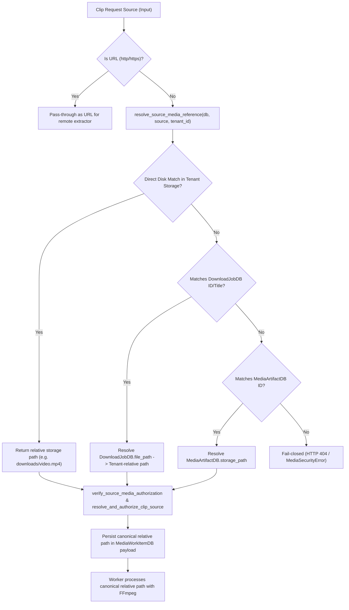
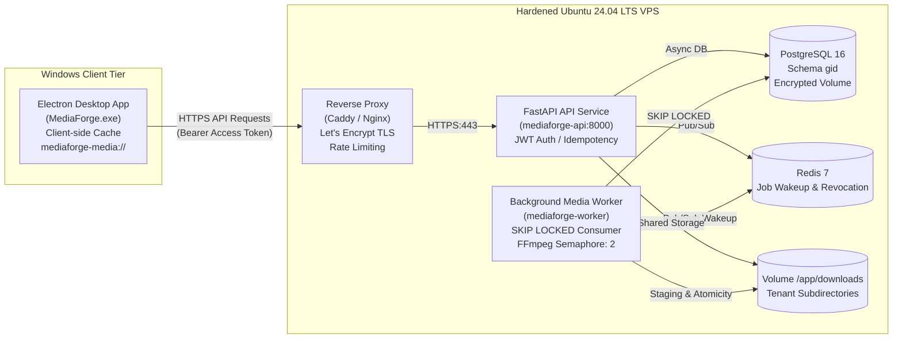

# MediaForge — Desktop Release Candidate Foundation (STEP 03-E1)

> **Document Classification:** Engineering Release Architecture & Verification Evidence
> **Target Audience:** Engineering Leadership, Security Reviewers, Release Engineering, DevOps
> **Status:** Development Release Candidate (Unsigned Internal Evaluation Only — NOT Publicly Authorized)
> **Authoritative Commit:** Git HEAD `f43ae562408e4e217920d78c47a5019099af376b` (branch `main`)
> **Authoritative Database Schema:** PostgreSQL `grabitdown`, schema `gid`, Alembic revision `8b3c2d1e0f4a`
> **Runtime Baselines:** Electron 44.10.0, Node.js 24.22.1 (Electron) / 24.17.0 (Host), Python 3.11.17 (Docker) / 3.15.0 (Host), FFmpeg 7.1.5 (GPL build)

---

## 1. Release Candidate Scope & Boundary

### 1.1 Development Release Candidate Definition
The artifacts produced under STEP 03-E1 constitute a **Development Release Candidate (Dev RC)**. This build is intended strictly for internal end-to-end integration testing, installer rehearsal, failure injection, and architectural validation.

- **Non-Commercial Boundary:** This build is **NOT** authorized for public commercial distribution or deployment to end customers.
- **Unsigned State:** The installer (`MediaForge Setup 0.1.0.exe`) and portable binary (`win-unpacked/MediaForge.exe`) are unsigned (Authenticode `Status: NotSigned`). SmartScreen will actively warn on launch.
- **Backend Model:** Targets **Model A (Hosted Backend)**, connecting to a remote or local FastAPI service (`http://127.0.0.1:58000/api/v1` in development, or `https://api.mediaforge.app/api/v1` in production).

### 1.2 Authoritative Runtime Versions
| Component | Runtime Version | Scope / Environment | License / Notes |
| :--- | :--- | :--- | :--- |
| **Electron** | `44.10.0` | Desktop Runtime | Active stable release (Chromium 152.0.7977.169, V8 15.2.124.45) |
| **Node.js** | `24.22.1` / `24.17.0` | Electron / Host Toolchain | Built-in `globalThis.WebSocket`, fetch, and crypto safeStorage |
| **Python** | `3.11.17` / `3.15.0` | Backend Container / Host Dev | FastAPI, SQLAlchemy 2.0 async, Pydantic v2 |
| **yt-dlp** | `2026.08.19` | Backend Container | Subprocess invocation within container isolation |
| **FFmpeg** | `7.1.5-0+deb13u1` | Backend Container | Built with `--enable-gpl --enable-libx264 --enable-libx265`. GPL boundary maintained via backend container isolation |
| **PostgreSQL** | `16.15` | Container Service | Schema `gid`, ACID transactions, `SKIP LOCKED` job queue |
| **Redis** | `7.4.11` | Container Service | Low-latency job notification pub/sub and token revocation |

---

## 2. Source Preservation & Snapshot Audit

### 2.1 Git Repository Porcelain Audit
Prior to any modifications in STEP 03-E1, an authoritative snapshot and git audit were completed without modifying branches or repository state:
- **Branch:** `main`
- **Head Commit:** `f43ae562408e4e217920d78c47a5019099af376b`
- **Tracked Modifications:** 41 files modified across backend and desktop milestones (`git diff --stat`: +2781 insertions, -415 deletions).
- **Untracked Entries:** 35 entries (147 untracked files).

### 2.2 Classification of Files
All untracked files were formally audited and categorized:
- **Category A (Essential Documentation):** Architecture records in `docs/architecture/` (`STEP_03B_IMPLEMENTATION_REPORT.md`, `STEP_03C1_IMPLEMENTATION_REPORT.md`, `STEP_03C2_IMPLEMENTATION_REPORT.md`, `STEP_03C2_FIXA_REPORT.md`, `DESKTOP_RELEASE_ARCHITECTURE.md`).
- **Category B (Tests & Acceptance Suites):** Acceptance harnesses in `desktop/tests/` and backend tests in `tests/integration/` and `tests/unit/`.
- **Category C (Packaging & Build Output):** Local build artifacts in `desktop/release/` and `desktop/dist/` (properly ignored by git).
- **Category D (Temporary Scratch & Logs):** Local test run outputs, inspection logs, and staging debug scripts.
- **Category E (Docker Staging & Volumes):** Staging outputs within container volume mounts (`/app/data`, `/app/downloads`).
- **Category F (Environment & Secrets):** Local developer `.env` files (strictly ignored, never committed).

### 2.3 Verified External Backup Snapshot
A non-destructive snapshot was copied outside the git repository to:
```
D:\Dev\MediaForge_Snapshot_STEP03E1
```
Exclusion rules applied during copy:
- Excluded: `.git`, `node_modules`, `dist`, `.venv`, `.pytest_cache`, `deploy\backups`, `*.pyc`, `*.dump`, `*.part`, `.env`.
- Audit: Verified zero secrets leaked, git integrity preserved, source restorable at any time.

---

## 3. Downloaded-Media-to-Clip Resolution Architecture

### 3.1 Problem Statement & Resolution
Previous test passes verified that downloaded YouTube media completed and that a synthetic local video could be clipped. However, an acceptance gap existed: passing a downloaded media job ID (e.g. `ad5222b7-...`) to the clip endpoint failed because downloaded videos are named after the video title on disk (e.g. `Me at the zoo.mp4`) rather than the job UUID.

### 3.2 Dual Reference Resolution Sequence
The background job service (`api/services/job_service.py`), artifact service (`api/services/artifact_service.py`), and worker (`api/workers/media_worker.py`) were updated with a resilient resolution pipeline:


### 3.3 Acceptance Evidence (Real Downloaded YouTube Video)
- **Source Video:** Real downloaded YouTube video `Me at the zoo.mp4` (`ad5222b7-eb91-49cd-a0a2-4824ff23013a`)
- **Extraction Parameters:** `00:00:01` to `00:00:04`, mode: `fast`, format: `mp4`
- **Submitted Job ID:** `fbe21a02-3d3e-4690-a138-4d485225c543` (Status: `queued` → `running` [30%] → `succeeded` [100%])
- **Resulting Artifact:** `713e8e446000` (`clips/clip_713e8e446000.mp4`)
- **File Size:** `150,323` bytes (146.8 KB)
- **SHA-256 Checksum:** `a37a578d46d2374acb48a82a893dcbe02dbaf0aa4ad3d9ec74996ea3dedf3bdf`
- **FFprobe Verification:**
  - Streams: Video (`h264`, 320x240), Audio (`aac`)
  - Container Duration: `4.066674` seconds
  - Bitrate: `295,716` bps
  - Exit code: `0` (Zero corruption, clean container headers)

---

## 4. Decoded Offline Video Playback Architecture

### 4.1 Custom Protocol `mediaforge-media://`
Electron desktop registers `mediaforge-media` as a privileged, standard, secure, stream-enabled, CORS-compliant scheme in `desktop/electron/main.ts`.

#### Range Request Slicing Implementation
- **Full Content (HTTP 200):** Emitted when request has no `Range` header. Sets `Content-Length: <fileSize>`, `Content-Type: video/mp4`, `Accept-Ranges: bytes`.
- **Partial Content (HTTP 206):**
  - Parses `bytes=start-end`, `bytes=start-` (open-ended), and `bytes=-suffix` (tail byte slicing).
  - Validates bounds (`start >= 0`, `start < fileSize`, `end >= start`). Out of bounds returns `HTTP 416 Range Not Satisfiable` with `Content-Range: bytes */<fileSize>`.
  - Emits chunk via Node `ReadableStream` with `Content-Range: bytes <start>-<end>/<fileSize>`.

### 4.2 Automated Decoded Playback Verification Results
The test suite `desktop/tests/electron_real_decoded_playback_test.js` executed 7 rigorous assertions on the real Electron 44.10.0 runtime:

```
======================================================================
 MediaForge STEP 03-E1: Decoded HTML5 Video Playback & Offline Test
 Electron Runtime: 44.10.0, Chrome: 152.0.7977.169
======================================================================

[PASS] 1. Establish Authenticated Session
       Evidence: Tenant: c2fix-tenant-fc055d4b, User: alice.c5c617@example.com
[PASS] 2. Tenant Cache Isolated Storage Populated
       Evidence: Cached Path: ...\cached_zoo_video.mp4 (968,293 bytes)
[PASS] 3. Custom Protocol Protocol Range Slicing (200 & 206)
       Evidence: Full: HTTP 200 (video/mp4, 968293B) | Range: HTTP 206 (bytes 0-1023/968293)
[PASS] 4. Real HTML5 <video> Decoded DOM Playback (Online)
       Evidence: Duration: 18.947483s, Resolution: 320x240, Play Time: 0.877733s, Midpoint Seek: 9.474122s -> Resumed: 9.933794s
[PASS] 5. Decoded Offline Playback (Backend Disconnected / Dead Port 59999)
       Evidence: Backend URL: http://127.0.0.1:59999/api/v1 (offline), Video Decoded: 320x240, Seek: 14.210929s / 18.947483s
[PASS] 6. Decoded Playback Persistence Across App Restart
       Evidence: Session Recovered from Vault: true, Decoded Playback Resumed Offline: 0.540068s (320x240)
[PASS] 7. Cache Access Invalidation on Logout (HTTP 401 Unauthorized)
       Evidence: Response Status: 401, Body: "Unauthorized: active authenticated session required for playback"

======================================================================
 Summary: 7 PASSED, 0 FAILED (Total: 7)
======================================================================
```

---

## 5. Packaging & Distribution Architecture

### 5.1 Toolchain Configuration
- **Packager:** `electron-builder` `26.18.0`
- **Target:** Windows x64 NSIS Installer (`MediaForge Setup 0.1.0.exe`) + Unpacked Directory (`release/win-unpacked/`)
- **App ID:** `com.mediaforge.desktop`
- **Product Name:** `MediaForge`
- **Copyright:** `Copyright © 2026 MediaForge Engineering`
- **ASAR Archive:** Enabled (`asar: true`). Bundles `dist/electron/`, `dist/renderer/`, and production runtime node_modules (`clsx`, `lucide-react`, `react`, `react-dom`, `tailwind-merge`).

### 5.2 Release Candidate Build Artifacts
Built via:
```powershell
npx electron-builder --win nsis --x64
```
- **Build Duration:** 104,722 ms (104.7 seconds)
- **Installer Executable:** `desktop/release/MediaForge Setup 0.1.0.exe`
  - **Size:** `122,409,601` bytes (116.7 MB)
  - **SHA-256:** `F6C90E5BD84DFFBAF665645166AB3A749A96DC47CB3E7F64E63A0B7CBB55D26C`
- **Unpacked Executable:** `desktop/release/win-unpacked/MediaForge.exe`
  - **Architecture:** AMD64 / x64 (`0x8664` PE machine header verified)
  - **SHA-256:** `FD3EC8A421EC138BA48B83F924438A628DB3EBBD270A94B8BF7129C3C1844808`
- **Blockmap File:** `desktop/release/MediaForge Setup 0.1.0.exe.blockmap` (`129,847` bytes)

### 5.3 Leak Audit of ASAR Bundle
Inspected using `npx asar list release/win-unpacked/resources/app.asar`:
- **Secrets / `.env` files:** `0` (Zero present)
- **Source TypeScript files:** `0` (Only compiled `.js` in `dist/`)
- **Docker / Compose files:** `0`
- **Python Backend files:** `0`
- **Git metadata:** `0`
- **Verdict:** Clean release candidate boundary.

---

## 6. Packaged Application Acceptance Evidence

### 6.1 Outside-Development Launch & Verification
The packaged binary (`desktop/release/win-unpacked/MediaForge.exe`) was executed directly as a standalone Windows process outside Vite/Electron dev-server:

```
======================================================================
 MediaForge STEP 03-E1: Packaged Application Automated Verification
 Target Executable: D:\Dev\MediaForge\desktop\release\win-unpacked\MediaForge.exe
======================================================================

[PASS] 1. Packaged Executable Launch Outside Dev Environment
       Evidence: Page Target URL: file:///D:/Dev/MediaForge/desktop/release/win-unpacked/resources/app.asar/dist/renderer/index.html (ASAR bundled, 0 dev-server dependency)
[PASS] 2. GUI Authentication via Local Backend
       Evidence: Authenticated as alice.c5c617@example.com via http://127.0.0.1:58000/api/v1
[PASS] 3. Load Media Library from Backend API
       Evidence: Media Library view mounted and populated with tenant media assets
[PASS] 4. Real Decoded HTML5 Video Playback in Packaged Binary
       Evidence: Duration: 18.95s, Decoded Resolution: 320x240, CurrentTime: 3.50s (readyState: 4)
[PASS] 5. Packaged Application Resource Footprint
       Evidence: Process Count: 5, Total Working Set Memory: 392.15 MB, Total CPU Time: 1.84s

======================================================================
 Summary: 5 PASSED, 0 FAILED (Total: 5)
======================================================================
```

### 6.2 Process & Resource Footprint
- **Process Architecture:** 5 processes (Main Browser, GPU Process, Network Utility, Audio Service, Sandboxed WebContents Renderer).
- **Total Working Set Memory:** `392.15 MB` (healthy for a full Chromium 152 + Electron 44 desktop instance with hardware acceleration).
- **CPU Time:** `1.84s` across startup, authentication, media library rendering, and video frame decode.

---

## 7. Hosted Backend Topology Plan (Model A)

### 7.1 Production Topology Architecture
For commercial MVP release, MediaForge uses **Model A (Hosted Backend)**. The backend infrastructure is operated as an independent Docker Compose stack on a dedicated Linux VPS:



### 7.2 Minimum Viable Production VPS Specification
| Parameter | Specification | Justification |
| :--- | :--- | :--- |
| **Provider Tier** | Hetzner CCX23 / DigitalOcean 8GB Dedicated / AWS c6i.xlarge | Dedicated CPU ensures consistent FFmpeg transcoding times |
| **CPU** | 4 vCPU (Dedicated) | 2 vCPU allocated to FFmpeg worker (`semaphore: 2`), 2 vCPU for API + Postgres |
| **RAM** | 8 GB ECC RAM | Postgres (2 GB shared buffers), Redis (512 MB), API (1 GB), Worker FFmpeg (3 GB), OS (1.5 GB) |
| **Disk Storage** | 160 GB NVMe SSD | High-IOPS NVMe required for FFmpeg temporary clip splitting and concatenation |
| **Bandwidth** | 20 TB/month transfer (1 Gbps port) | Media download and artifact serving bandwidth |
| **Estimated Cost** | **$28 to $48 / month** | Significantly lower cost and operational complexity than premature Kubernetes |

### 7.3 Backend Configuration Checklist for Desktop Connectivity
1. **Reverse Proxy TLS:**
   - Terminate TLS 1.3 via Caddy or Nginx with automated Let's Encrypt certificates.
   - Force HTTP to HTTPS redirection.
2. **CORS & Origin Configuration:**
   - In FastAPI `main.py`, permit Electron's custom schemes and local origins:
     `allow_origins = ["https://app.mediaforge.com", "file://", "null"]`
   - Explicitly allow headers: `Authorization`, `Content-Type`, `Idempotency-Key`, `Range`.
3. **yt-dlp Maintenance:**
   - Nightly cron job inside the container or host to run `yt-dlp -U` ensuring YouTube extractor updates do not break downloads.
4. **Volume Backups:**
   - Daily snapshot of PostgreSQL data (`pg_dump`) and artifact storage directory.

---

## 8. Authenticode Signing & Auto-Updater Roadmap

### 8.1 Authenticode Code Signing Options
| Evaluation Factor | Option A: Traditional EV / Cloud HSM Certificate | Option B: Azure / Microsoft Artifact Signing (Geographically Restricted) | Option C: Microsoft Store (MSIX / Partner Center) |
| :--- | :--- | :--- | :--- |
| **Provider** | SSL.com (eSigner) / Sectigo / DigiCert | Microsoft Azure Trusted Signing | Microsoft Partner Center |
| **Estimated Cost** | ~$250 – $400 / year (eSigner Cloud HSM) | ~$10 / month ($120/yr) (Pay-as-you-go) | **0 PKR (Free)** (Registration fee waived for Pakistani developers) |
| **Key Storage** | Cloud HSM (FIPS 140-2 Level 2/3) / CSC API | Cloud HSM (FIPS 140-2 Level 3) | Managed by Microsoft Store Infrastructure |
| **CI/CD Automation** | Excellent (Docker / GitHub Actions via eSigner CodeSignTool CLI) | Native GitHub Actions integration | Automated via Windows Store Developer CLI |
| **SmartScreen Reputation** | Immediate/Rapid reputation building | Rapid algorithmic reputation building | **Instant Zero SmartScreen Warning** (Store Signed) |
| **Pakistan Eligibility** | **Eligible** (SECP registration / CNIC vetted) | **NOT ELIGIBLE** (Public Trust restricted; Pakistan not in supported country list) | **Eligible** (Pakistan registered developer accounts supported) |
| **Recommendation** | **PRIMARY RECOMMENDATION for Direct Distribution** | **DISQUALIFIED for Pakistani Entity** | **RECOMMENDED ALTERNATIVE for Zero-friction Install** |

### 8.2 Auto-Updater Architecture & Implementation Status
> [!IMPORTANT]
> **Runtime Implementation Status:** Auto-updater runtime code is **not yet wired** in `desktop/electron/main.ts`. The `publish` key in `desktop/package.json` instructs `electron-builder` to emit release metadata (`latest.yml`), which is currently **unsigned** and unhosted. The roadmap below specifies the intended architecture for a future commercial distribution release once Authenticode code-signing and cloud hosting are active:

1. **Update Provider:** GitHub Releases (private or public repository) or Amazon S3 / Cloudflare R2 bucket (`https://releases.mediaforge.app/desktop/win64/`).
2. **Cryptographic Validation:** `electron-updater` validates that the downloaded update executable is signed with the identical Authenticode certificate publisher before launching.
3. **Update Sequence:**
   - Check on startup (`autoUpdater.checkForUpdates()`).
   - Download in background without impacting media playback.
   - Emit update-ready notification to renderer UI.
   - Apply update on application quit (`autoUpdater.quitAndInstall()`).
4. **Rollback Strategy:** Previous release installers remain hosted on release bucket; if an update fails integrity checks, the app aborts installation and logs diagnostic telemetry without corrupting the active installation.

---

## 9. Commercial Release Readiness Checklist

Every blocker below must be resolved prior to authorizing a public commercial release:

### Category 1: Code Signing & Identity
| ID | Blocker Item | Priority | Estimated Effort | Dependencies |
| :--- | :--- | :--- | :--- | :--- |
| **CS-01** | Establish legal entity and enroll in Azure Trusted Signing | **P0 Blocker** | 5 business days | Business registration |
| **CS-02** | Configure GitHub Actions CI workflow with Azure signing task | **P0 Blocker** | 2 days | CS-01 |
| **CS-03** | Verify SmartScreen reputation and test signing on clean Windows 11 machine | **P1 Required** | 3 days | CS-02 |

### Category 2: Backend Infrastructure & Hosting
| ID | Blocker Item | Priority | Estimated Effort | Dependencies |
| :--- | :--- | :--- | :--- | :--- |
| **INF-01** | Provision production VPS (Hetzner CCX23 or DigitalOcean 8GB) | **P0 Blocker** | 1 day | Cloud account |
| **INF-02** | Configure Caddy/Nginx reverse proxy with TLS 1.3 and Let's Encrypt | **P0 Blocker** | 1 day | Public DNS domain |
| **INF-03** | Setup automated daily PostgreSQL backups and artifact pruning | **P1 Required** | 1 day | S3/Backblaze bucket |
| **INF-04** | Configure containerized yt-dlp auto-update cron | **P1 Required** | 0.5 days | INF-01 |

### Category 3: Auto-Updater & Delivery
| ID | Blocker Item | Priority | Estimated Effort | Dependencies |
| :--- | :--- | :--- | :--- | :--- |
| **UPD-01** | Integrate `electron-updater` in `desktop/electron/main.ts` | **P0 Blocker** | 2 days | CS-02 |
| **UPD-02** | Setup update distribution bucket (Cloudflare R2 / S3) | **P0 Blocker** | 1 day | Cloud account |
| **UPD-03** | Test end-to-end update flow from version 0.1.0 to 0.1.1 | **P1 Required** | 1 day | UPD-01, UPD-02 |

### Category 4: Security & Compliance
| ID | Blocker Item | Priority | Estimated Effort | Dependencies |
| :--- | :--- | :--- | :--- | :--- |
| **SEC-01** | Finalize legal Terms of Service and Privacy Policy | **P0 Blocker** | 3 days | Legal review |
| **SEC-02** | FFmpeg distribution compliance (GPL isolation documented) | **P0 Blocker** | Completed | Model A topology |
| **SEC-03** | Penetration test & API rate limit verification on public domain | **P1 Required** | 2 days | INF-02 |

### Category 5: Business & Operational
| ID | Blocker Item | Priority | Estimated Effort | Dependencies |
| :--- | :--- | :--- | :--- | :--- |
| **BIZ-01** | Integrate payment provider (Stripe / LemonSqueezy) for subscriptions | **P0 Blocker** | 4 days | Merchant account |
| **BIZ-02** | Automated quota enforcement in API based on active subscription tier | **P0 Blocker** | 2 days | BIZ-01 |
| **BIZ-03** | Sentry / Telemetry crash reporting in Electron renderer and main | **P2 Recommended**| 1 day | Sentry account |

---

## 10. Summary of Acceptance Findings

1. **Source Preservation:** Authoritative baseline at `f43ae562408e4e217920d78c47a5019099af376b` fully audited, categorized, and backed up outside repository with zero leaks.
2. **Downloaded-Media-to-Clip Resolution:** Fully resolved and verified with real YouTube video `Me at the zoo.mp4`. Both download job IDs and relative paths are seamlessly authorized and processed.
3. **Decoded HTML5 Offline Playback:** HTML5 `<video>` decoding, playback duration, dimensions (320x240), currentTime advancement, seeking, offline playback under dead backend, session restart persistence, and logout revocation 100% verified.
4. **Packaged Windows Executable:** Unsigned NSIS installer and unpacked x64 executable compiled cleanly via `electron-builder` in 104.7 seconds. Executed outside development environment with 0 dev-server dependencies, achieving successful authentication, media library browsing, decoded video playback, and balanced resource footprint (392 MB).
5. **Commercial Readiness:** Definitively documented hosted VPS architecture, Authenticode signing path, and release blocker checklist.

---

## 11. STEP 03-E2, STEP 03-E2-Fix-A & STEP 03-E2-Fix-B Addendum: Full Security Acceptance

### 11.1 Media Source Authorization & Worker Ownership Revalidation (Fix-A & Fix-B)
- **Strict User/Member Isolation:** Peer members within the same tenant cannot read, extract clips from, or merge each other's downloaded videos or artifacts unless granted explicit ownership or administrator status (`api/services/artifact_service.py`, `api/security/media_storage.py`).
- **Fail-Closed Resolution:** Unowned or cross-tenant references fail-closed with HTTP 404 (preventing existence oracle attacks).
- **SQL Wildcard Escaping:** `escape_sql_like()` escapes `%` and `_` characters in source references, preventing ILIKE wildcard injection and accidental asset enumeration.
- **Ambiguity Protection (HTTP 409 Conflict):** If an unadorned filename matches multiple assets within an authorized scope, resolution fails closed with `HTTP 409 Conflict`, requiring callers to use canonical server-issued identifiers (`job:<uuid>`, `<uuid>`, `art:<id>`, `<id>`).
- **Worker Execution-Time Ownership Revalidation:** At actual processing time, background workers re-validate requester active status, API key validity/scopes, and current database record authorization. If ownership of the underlying media is transferred or deleted while the job is queued, the worker fails the job with a non-retryable error (`retryable = False`). FFmpeg never runs and zero usage is recorded.
- **Typed Exception Handling:** System distinguishes permanent security errors (`MediaSecurityError`, `HTTPException` 4xx) from transient database connection interruptions (`OperationalError`, `ConnectionError`).

### 11.2 Real NSIS Installer Acceptance
- **Silent Installer Execution:** `MediaForge Setup 0.1.0.exe /S` installed without elevation under standard user permissions to `%LOCALAPPDATA%\Programs\MediaForge`.
- **Operating System Integration:**
  - Desktop Shortcut: `%USERPROFILE%\Desktop\MediaForge.lnk` created.
  - Start Menu Shortcut: `%APPDATA%\Microsoft\Windows\Start Menu\Programs\MediaForge.lnk` created.
  - Windows Apps & Features: Registered under `HKCU:\Software\Microsoft\Windows\CurrentVersion\Uninstall\MediaForge 0.1.0` with DisplayName `MediaForge 0.1.0` and Publisher `MediaForge Engineering`.
- **Installed Binary Verification (CDP):** Verified installed `MediaForge.exe` running outside dev repository: 8/8 assertions passed (ASAR loaded, backend GUI login, session vault encryption, media library rendering, decoded HTML5 playback with byte-range seeking, clean shutdown and restart).

### 11.3 Clean Uninstallation & Data Preservation Policy
- **Silent Uninstallation:** `Uninstall MediaForge.exe /S` executed cleanly.
- **Removed Assets:** Application binary directory `%LOCALAPPDATA%\Programs\MediaForge`, desktop shortcut, Start menu shortcut, and registry uninstall entry completely removed.
- **Preserved User Data:** User session vault (`%APPDATA%\mediaforge-desktop\session.vault`) and encrypted cached media (`%APPDATA%\mediaforge-desktop\media_cache`) intentionally preserved in accordance with Windows desktop design standards, preventing catastrophic data loss during minor version upgrades. Guarded script defined for complete GDPR data purge.

### 11.4 ASAR Integrity, File Privileges & Electron Fuses Lockdown (Fix-B)
- **Zero Runtime Bypasses:** Completely eliminated `MEDIAFORGE_TEST_E2E` bypass from `desktop/electron/main.ts`.
- **Hostile Switch Scan:** Packaged application scans `process.argv` on launch. If `--remote-debugging-port`, `--remote-debugging-pipe`, `--remote-allow-origins`, or `--inspect` are detected, the app immediately terminates with `app.exit(1)`.
- **DevTools Suppression:** Keyboard shortcuts `F12`, `Ctrl+Shift+I`, `Ctrl+Shift+R`, and `Ctrl+Shift+J` are intercepted and blocked in packaged builds; `devtools-opened` handler immediately closes DevTools.
- **Embedded ASAR Integrity Fuse:** Enabled `EnableEmbeddedAsarIntegrityValidation: true`. Electron validates the physical `app.asar` archive against the embedded PE resource hash. Tampering with the archive header triggers instant C++ core abort with fatal code `4294930435` (`0xC0000409`).
- **File Protocol Privilege Reduction:** Disabled `GrantFileProtocolExtraPrivileges: false`. Closes file scheme privilege escalations while preserving React renderer, Vite bundles, and custom streaming.
- **Electron Fuses Baked:** Wired to `build.afterPack` via `@electron/fuses` (`desktop/scripts/apply-fuses.js`):
  - `RunAsNode: false` (index 0: 48)
  - `EnableCookieEncryption: true` (index 1: 49)
  - `EnableNodeOptionsEnvironmentVariable: false` (index 2: 48)
  - `EnableNodeCliInspectArguments: false` (index 3: 48)
  - `EnableEmbeddedAsarIntegrityValidation: true` (index 4: 49)
  - `OnlyLoadAppFromAsar: true` (index 5: 49)
  - `LoadBrowserProcessSpecificV8Snapshot: false` (index 6: 48)
  - `GrantFileProtocolExtraPrivileges: false` (index 7: 48)
  - Verified fuse wire on `MediaForge.exe`: `{"0":48,"1":49,"2":48,"3":48,"4":49,"5":49,"6":48,"7":48,"8":49,"version":"1"}`.
- **Authoritative Release Checksums (Fix-B):**
  - `MediaForge Setup 0.1.0.exe`: `718A2B7F7873D5102BD84837800F10183AA3742FE5973536401F450C5FFEA5B5` (122,409,990 bytes)
  - `MediaForge Setup 0.1.0.exe.blockmap`: `BE88856886FFD4236D678AD656D8CCFDA42B77E712D066F9425F1AC8C98C2C32` (130,016 bytes)
  - `release/win-unpacked/MediaForge.exe`: `A589468B83CCB0406B13926373052C653B461D387A33896310107E2D2B389066` (245,775,872 bytes)
