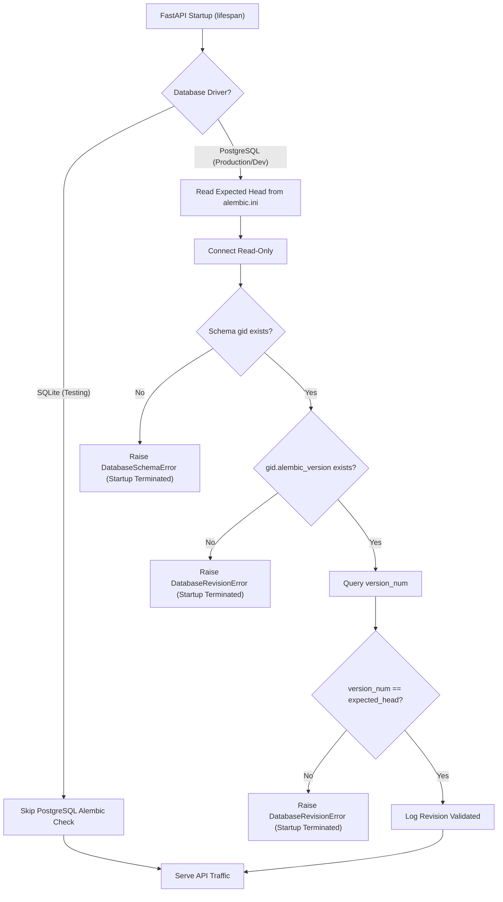

# MediaForge Database Lifecycle, Role Separation, & Access Security

## 1. Overview & Architectural Principles

In MediaForge (GrabItDown), database lifecycle and access control adhere to the principle of least privilege, strict defense-in-depth, and deterministic migration tracking:

1. **No Automatic DDL at Runtime**: `Base.metadata.create_all` has been completely eliminated from FastAPI application startup. Schema evolution is managed exclusively through Alembic migrations.
2. **Read-Only Startup Migration Validation**: During application startup lifespan, FastAPI connects to PostgreSQL and validates that the database is migrated to the repository's expected Alembic head revision (`dd1604fa6959`). If the schema is missing, unmigrated, outdated, or ambiguous, startup terminates safely with clear actionable logging and zero credential leakage.
3. **Segregated Role Privilege Model**:
   - Administrative / Migration Role (`gid_user`): Schema owner with full DDL permissions, used only by CI/CD and Alembic CLI.
   - Application Runtime Role (`gid_app`): Least-privilege user with DML permissions (`SELECT`, `INSERT`, `UPDATE`, `DELETE`) only. Zero DDL authority (cannot `CREATE`, `ALTER`, or `DROP` tables).
4. **Decoupled Database Seeding**: Automatic default tenant/user creation has been removed from the API startup lifespan. Seeding is strictly an explicit, idempotent administrative task.

---

## 2. Segregated Database Roles

| Dimension | Migration Role (`gid_user`) | Application Runtime Role (`gid_app`) |
|---|---|---|
| **Role Type** | Administrative / DDL | Runtime Application / DML |
| **Database Access** | `CONNECT`, `TEMPORARY` on `grabitdown` | `CONNECT`, `TEMPORARY` on `grabitdown` |
| **Schema Scope** | Owner of `gid` (`CREATE`, `USAGE`) | `USAGE` on `gid` (`CREATE` revoked) |
| **Table Permissions** | Full DDL & DML (`CREATE`, `ALTER`, `DROP`, `TRUNCATE`, `SELECT`, `INSERT`, `UPDATE`, `DELETE`) | DML only: `SELECT`, `INSERT`, `UPDATE`, `DELETE` |
| **DDL Authority** | Yes | **NO** (Denied by engine) |
| **Table Ownership** | Owner of all 7 domain tables + version table | Non-owner |
| **Sequence Permissions** | Full ownership | `USAGE`, `SELECT` |
| **Default Privileges** | Automatically grants DML to `gid_app` for new objects | N/A |
| **Intended Usage** | Alembic CLI, migration pipelines | FastAPI web server, background workers |

---

## 3. Segmented Database Connection Configuration

Configuration variables are organized by role and deployment environment in `deploy/.env` and `deploy/.env.example`:

```env
# 1. Runtime Application Access (Least-Privilege DML: gid_app) - Host / Windows Dev
GID_API_DATABASE_URL=postgresql+asyncpg://gid_app:<STRONG_PASSWORD>@127.0.0.1:55432/grabitdown

# 2. Runtime Application Access (Least-Privilege DML: gid_app) - Docker Container Network
GID_APP_DOCKER_DATABASE_URL=postgresql+asyncpg://gid_app:<STRONG_PASSWORD>@postgres:5432/grabitdown

# 3. Alembic Migrations Access (Schema Owner / DDL: gid_user) - Host / Windows Dev
GID_MIGRATION_DATABASE_URL=postgresql+asyncpg://gid_user:<MIGRATOR_PASSWORD>@127.0.0.1:55432/grabitdown

# 4. Standard Synchronous Fallback URL
DATABASE_URL=postgresql://gid_app:<STRONG_PASSWORD>@127.0.0.1:55432/grabitdown
```

### Routing Rules in Application Code
- **Alembic Engine** (`api/database/migrations/env.py`):
  Uses `settings.migration_database_url` (`gid_user`) if configured, ensuring migrations run with schema ownership and DDL rights.
- **FastAPI Lifespan & Dependency Injection** (`api/main.py`, `api/database/connection.py`):
  Uses `settings.database_url` (`gid_app`), guaranteeing that any SQL executed by application endpoints is restricted to non-destructive DML.
- **Credential Protection**:
  Error messages and logs use `settings.sanitized_database_url` which masks passwords (`user:***@host:port/db`).

---

## 4. Read-Only Startup Revision Validation

The validator module (`api/database/validator.py`) implements deterministic lifecycle checks before traffic is served:



### Safety Properties:
1. **Never Automatically Migrates**: The application strictly refuses to run `alembic upgrade` at startup. Migrations must be run prior to container deployment.
2. **Ambiguity Detection**: Multiple version records or multiple migration branch heads trigger startup failure.
3. **No Credential Exposure**: Logs contain only schema names, table names, and revision IDs.

---

## 5. Role Provisioning & Maintenance Utilities

1. **Docker Container First-Boot**:
   - `deploy/postgres/init/01-init-database.sh`: Creates database `grabitdown`, schema `gid`, extensions, and migrator role `gid_user`.
   - `deploy/postgres/init/02-provision-roles.sh`: Creates runtime role `gid_app`, locks down `public` schema, grants DML on `gid`, and establishes default privileges.
2. **On-Demand Windows Reconciliation**:
   ```powershell
   powershell.exe -ExecutionPolicy Bypass -File deploy/scripts/Provision-Roles.ps1
   ```

---

## 6. Decoupled Database Seeding

Implicit seeding in `api/main.py` has been removed. Seeding is executed explicitly via:

```powershell
# Option 1: PowerShell Utility
powershell.exe -ExecutionPolicy Bypass -File deploy/scripts/Seed-Database.ps1

# Option 2: Python Module Execution
python -m api.services.seed
```

**Idempotency Guarantee**: `seed_defaults()` queries for existing `slug == 'default'` tenant and `email == 'system@grabitdown.local'` user before insertion. Re-running produces zero duplicate rows or constraint violations.

---

## 7. Remaining Tasks for STEP 01-B2

With database lifecycle security and role separation operational, STEP 01-B2 will address:
1. **Production Docker Compose Packaging**: Create a dedicated `api` service container in `deploy/docker-compose.yml` consuming `GID_APP_DOCKER_DATABASE_URL`.
2. **Migration Entrypoint Container**: Implement an ephemeral migration job container running `alembic upgrade head` under `gid_user` before starting the application service.
3. **Healthcheck Endpoint Integration**: Enhance `/api/v1/health` with a shallow database ping verifying connection pool liveness.
