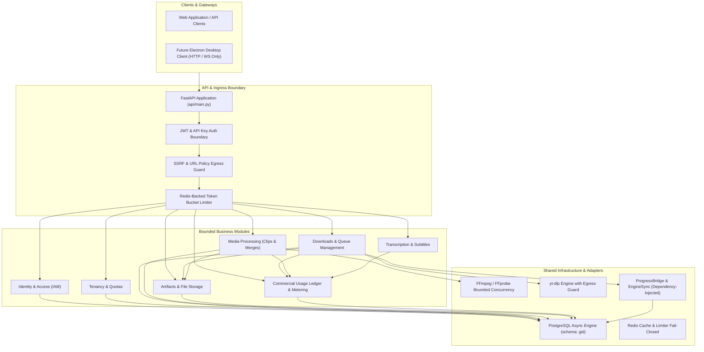
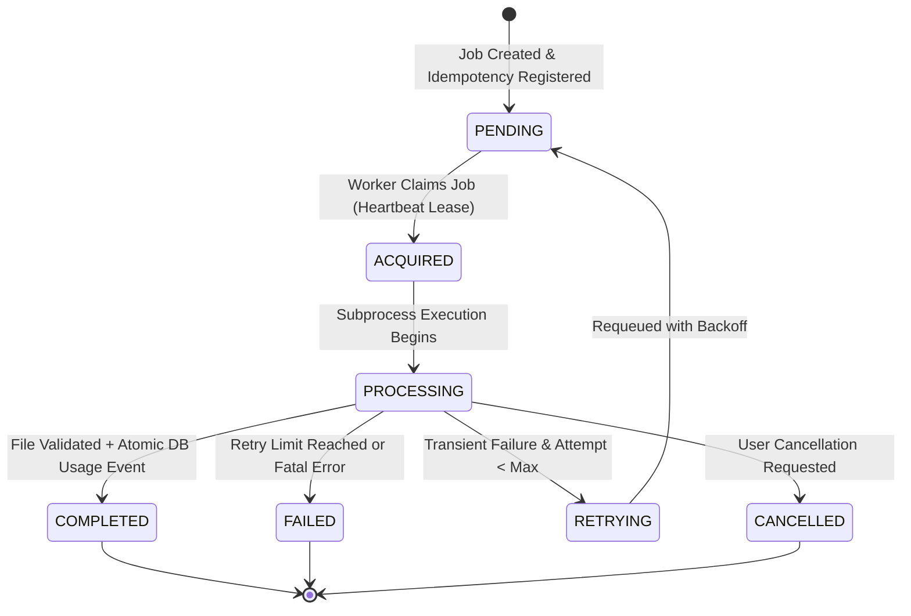

# MediaForge — Modular-Monolith Architecture

## 1. Executive Summary & Architecture Vision

MediaForge is evolved into a high-reliability **modular monolith**. It organizes business capabilities into cohesive, bounded domain modules while executing within a single Python/FastAPI process and shared PostgreSQL/Redis infrastructure.



---

## 2. Logical Business Modules & Ownership

The application is structured into eight explicit logical modules. Each module owns its internal domain logic, data models, and business invariants:

| Module | Core Responsibilities | Key Database Models | Primary Code Locations |
| :--- | :--- | :--- | :--- |
| **1. Identity & Access** | User authentication, password recovery, email verification, user sessions, JWT issuance/validation, and scoped API key management. | `UserDB`, `SessionDB`, `APIKeyDB`, `RegistrationTokenDB`, `PasswordResetTokenDB` | `api/routers/auth.py`<br>`api/routers/api_keys.py`<br>`api/security/`<br>`api/services/session_service.py`<br>`api/services/api_key_service.py` |
| **2. Tenancy** | Multi-tenant organization boundaries, tenant tiers, tenant-scoped context injection, and intra-tenant role-based access control. | `TenantDB`, `TenantQuotaDB` | `api/dependencies.py` (`CurrentUser`)<br>`TenantDB`<br>`api/routers/features.py` |
| **3. Downloads** | Source URL validation, metadata resolution, batch/playlist queuing, yt-dlp execution, download lifecycle state transitions, and real-time progress. | `DownloadJobDB`, `DownloadHistoryDB` | `api/routers/downloads.py`<br>`api/routers/queue.py`<br>`api/routers/resolve.py`<br>`src/download/`<br>`api/services/download_service.py` |
| **4. Media Processing** | Offline video/audio clipping (`fast` keyframe copy vs `precise` re-encode), multi-clip concatenation/merging, FFmpeg argument sanitization, and bounded execution concurrency. | Output recorded in `MediaArtifactDB` | `api/routers/clips.py`<br>`api/routers/clips_merge.py`<br>`src/clip/extractor.py`<br>`src/clip/merger.py` |
| **5. Transcription** | Subtitle/caption retrieval (non-billable download) and future AI speech-to-text processing (Whisper). | `TranscriptDB` | `api/routers/transcripts.py`<br>`src/transcript/` |
| **6. Artifacts & Storage** | Persistent media artifact lifecycle (`processing` → `ready` / `failed`), SHA-256 checksum verification, tenant-isolated disk storage (`/mediaforge/downloads/<tenant_id>/...`), path traversal prevention, retention enforcement, and storage reconciliation. | `MediaArtifactDB` | `api/routers/artifacts.py`<br>`api/services/artifact_service.py`<br>`api/services/retention_service.py`<br>`api/services/reconcile_artifacts.py`<br>`api/security/media_storage.py` |
| **7. Usage & Quotas** | Commercial usage event recording, database-enforced idempotency, consumption attribution (tenant/user/API-key), tenant ledger reporting, and advisory quota evaluation. | `UsageEventDB`, `TenantQuotaDB`, `UsageTrackingDB` | `api/routers/usage.py`<br>`api/services/usage_service.py`<br>`api/services/reconcile_usage.py` |
| **8. Shared Infrastructure** | Async PostgreSQL connection pooling, Redis caching & token bucket rate limiting, application configuration, error sanitization, WebSocket broadcast bridges, and process lifecycle. | Leaf infrastructure | `api/config.py`<br>`api/database/connection.py`<br>`api/middleware/`<br>`api/services/progress_bridge.py`<br>`api/services/engine_sync.py` |

---

## 3. Dependency Rules & Boundaries

To preserve architectural integrity and prevent spaghetti code, the following strict dependency rules are enforced:

1. **Direction of Invocations**:
   - HTTP Routers depend on Domain Services.
   - Domain Services depend on Database Models, Repositories, and Shared Infrastructure.
   - Domain modules **never** invoke HTTP router endpoints internally to accomplish business logic.
2. **Elimination of Circular Dependencies**:
   - Shared infrastructure (such as `ProgressBridge` and `EngineSync`) must not import `api.dependencies`. Dependencies are injected via explicit setters (`set_app`, `set_engine`) at startup.
   - Circular imports across domain services are strictly prohibited.
3. **Database Model Isolation**:
   - Modules write only to their owned tables.
   - Cross-domain queries (e.g. checking if a source media file belongs to a download job) are performed through explicit service contract methods (`verify_source_media_authorization`).
4. **Tenant Authority**:
   - `tenant_id` is always derived from server-validated credentials (`CurrentUser.tenant_id`) and is never accepted from unverified request payloads.

---

## 4. Priority Service Contracts (Implemented Refactoring)

Two priority internal service boundaries have been established:

### Boundary A: Usage Metering Internal Service Contract (`api/services/usage_service.py`)

The usage metering subsystem is encapsulated behind a reusable service contract that internal pipelines call directly:

```python
async def record_usage_event(
    session: AsyncSession,
    *,
    tenant_id: str,
    event_type: str,
    idempotency_key: str,
    resource_id: str | None = None,
    quantity: float = 1.0,
    unit: str = "count",
    bytes: int = 0,
    duration_seconds: float = 0.0,
    user_id: str | None = None,
    api_key_id: str | None = None,
    auth_method: str = "jwt",
    client_ip: str | None = None,
    metadata_json: dict[str, Any] | None = None,
) -> tuple[UsageEventDB, bool]:
    """Atomic in-transaction usage event insertion with database idempotency."""
```

**Domain Specialized Operations**:
- `record_download_usage(...)`
- `record_clip_usage(...)`
- `record_merge_usage(...)`
- `record_transcription_usage(...)` (Whisper AI transcription)
- `record_subtitle_usage(...)` (Non-billable caption download)
- `get_tenant_usage_summary(...)`
- `get_tenant_usage_events(...)`
- `get_tenant_advisory_quotas(...)`

### Boundary B: Artifact Lifecycle & Media Coordination Contract (`api/services/artifact_service.py`)

Media processing operations coordinate file lifecycle transitions and usage accounting atomically:

```python
async def complete_artifact_in_fresh_session(
    artifact_id: str,
    duration_seconds: float,
    file_size_bytes: int,
    sha256_checksum: str,
    metadata_update: dict[str, Any] | None = None,
    usage_event_kwargs: dict[str, Any] | None = None,
) -> None:
    """Transition artifact to 'ready' and atomically insert usage event in one commit."""

async def fail_artifact_in_fresh_session(
    artifact_id: str,
    raw_error: str,
) -> None:
    """Transition artifact to 'failed' and record sanitized diagnostic error."""
```

---

## 5. Transaction Ownership & Atomicity Invariants

1. **In-Transaction Completion Atomicity**:
   When a media operation (clip extraction, merge, or download) finishes:
   - The media artifact / download job record is updated to `ready` / `completed`.
   - The authoritative `UsageEventDB` record is inserted into the ledger.
   - Both updates commit inside the **exact same database transaction**.
   - If either operation fails, the transaction is rolled back, preventing orphaned ledger events or unbilled media usage.
2. **Decoupled Failure Auditing**:
   If processing fails during execution (e.g. FFmpeg error or invalid codec), the error state is recorded in a fresh database session via `fail_artifact_in_fresh_session`, ensuring the failure is persisted even if previous operations rolled back.
3. **Idempotency Conflict Rejection**:
   If an incoming request reuses an `idempotency_key` but provides conflicting accounting data (different bytes, duration, or resource), the transaction aborts with `IdempotencyConflictError` mapping to `HTTP 409 Conflict`.

---

## 6. Security Boundaries & Invariants

| Guardrail | Mechanism | Invariant |
| :--- | :--- | :--- |
| **Deny-by-Default Ingress** | FastAPI `Depends(get_current_user)` | All protected routes require a valid JWT Bearer token or `X-API-Key`. Unauthenticated requests return `HTTP 401 Unauthorized`. |
| **Public Usage Ingestion Blocked** | `POST /api/v1/usage/events` check | Customer users and commercial API keys fail closed with `HTTP 403 Forbidden`. Customers cannot inject arbitrary usage events. |
| **Tenant Isolation** | Schema-level and query-level filtering | Every database query filters by `tenant_id == user.tenant_id`. Intra-tenant member scoping prevents members from accessing other members' files. |
| **Anti-Enumeration** | Consistent 404 responses | Attempting to access non-owned or cross-tenant resources returns `HTTP 404 Not Found` with generic error details. |
| **SSRF Defense** | `install_yt_dlp_egress_guard()` | Intercepts HTTP connections and redirect chains; loopback (`127.0.0.1`), link-local, private RFC 1918 subnets, and cloud metadata IPs (`169.254.169.254`) are blocked. |
| **Storage Traversal Prevention** | `Path.is_relative_to(tenant_root)` | All artifact and download paths are validated to stay within the tenant's assigned directory. Path traversal attempts (`../`) are rejected with `HTTP 400`. |
| **Non-Root Execution** | Docker user `appuser:appgroup` | Container executes as UID/GID `10001:10001`. Host filesystem and Docker daemon cannot be compromised from container. |

---

## 7. Future Background Job Worker Contract (Design-Only)

Currently, media downloads, clipping, and merging execute asynchronously within server thread pools and bounded subprocess pools (`get_ffmpeg_semaphore()`). For high scale, MediaForge will extract execution to background workers (e.g. ARQ/Redis or PostgreSQL worker queues).

### Durable Job Envelope Contract

A future background worker job payload must adhere to the following schema:

```json
{
  "job_id": "job_9b3e1c04-7a2e-4b9d-b81e-18a7c29d01e2",
  "tenant_id": "tenant-01e4a7b2",
  "requester": {
    "user_id": "user-4b7e9a1c",
    "api_key_id": "key-c82e1b04",
    "auth_method": "api_key"
  },
  "operation_type": "clip_extract",
  "idempotency_key": "clip:9b3e1c04",
  "inputs": {
    "source_ref": "source_video.mp4",
    "start_time": "00:00:10.000",
    "end_time": "00:00:25.000",
    "mode": "precise"
  },
  "resource_limits": {
    "timeout_seconds": 300,
    "max_output_bytes": 524288000,
    "concurrency_group": "ffmpeg_tenant_pool"
  },
  "attempt_count": 1,
  "max_attempts": 3,
  "created_at": "2026-10-23T04:30:00Z"
}
```

### Job Lifecycle State Machine



### Worker Trust & Crash Recovery
- **Machine-to-Machine Boundary**: Workers authenticate using mutual TLS (mTLS) or dedicated asymmetric HMAC tokens, not user or admin JWTs.
- **Heartbeat & Orphan Recovery**: Jobs maintain a `lease_expires_at` timestamp. If a worker crashes mid-processing, a supervisory daemon resets expired processing jobs to `PENDING` or `FAILED`.
- **Re-entrant Idempotency**: Because usage events require unique `(tenant_id, idempotency_key)`, replaying a partially completed job safely deduplicates in PostgreSQL.

---

## 8. Future Electron Desktop Client Application Contract (Design-Only)

The future Electron desktop application interacts with MediaForge strictly through **HTTP REST and WebSocket interfaces on `http://127.0.0.1:58000`**.

### Core Invariants for Electron Integration
1. **Zero Direct Database Connections**:
   The Electron client never opens connections to PostgreSQL (Port 55432) or Redis (Port 26379). All state mutations and queries route through FastAPI endpoints.
2. **Localhost API Binding**:
   MediaForge binds to `127.0.0.1:58000`, preventing external network interception.
3. **Pydantic Response Schemas**:
   All endpoints return versioned, strictly typed JSON responses matching Pydantic schemas, enabling automated TypeScript type generation (`openapi-typescript`).
4. **Real-time Event Stream**:
   The client connects to `ws://127.0.0.1:58000/api/v1/ws` to receive job progress, download completion, and system notifications without HTTP polling.

---

## 9. Dependency Cycle & Coupling Audit

During the STEP 03-A architecture audit:
- **Discovered Cycle**: An import cycle was detected between `api.dependencies` and `api.services.progress_bridge` / `api.services.engine_sync` due to engine synchronization callbacks needing `get_app()`.
- **Resolution**: Implemented dependency injection in `progress_bridge.py` (`set_app`) and `engine_sync.py` (`set_engine`). When `api.dependencies:get_app()` initializes the singleton engine, it pushes references down to the bridges.
- **Verification**: AST traversal across all modules in `api/` confirms **0 dependency cycles**.

---

## 10. Technical Debt & Deferred Work

1. **Job Table Consolidation**:
   Currently, `gid.download_jobs` and `gid.media_artifacts` exist as separate tables with distinct schemas. In a future milestone, unifying these under a polymorphic `gid.jobs` table will simplify worker scheduling.
2. **Distributed Queue Implementation**:
   Subprocess execution currently relies on `asyncio.to_thread` and an in-memory `threading.Semaphore`. Transitioning to a distributed worker system (e.g. ARQ with Redis streams) is deferred to subsequent architectural phases.
3. **Legacy Usage Tracking Table**:
   `gid.usage_tracking` is maintained alongside `gid.usage_events` to support legacy client dashboards. Once all consumers transition to `/api/v1/usage/summary`, this table can be deprecated.
