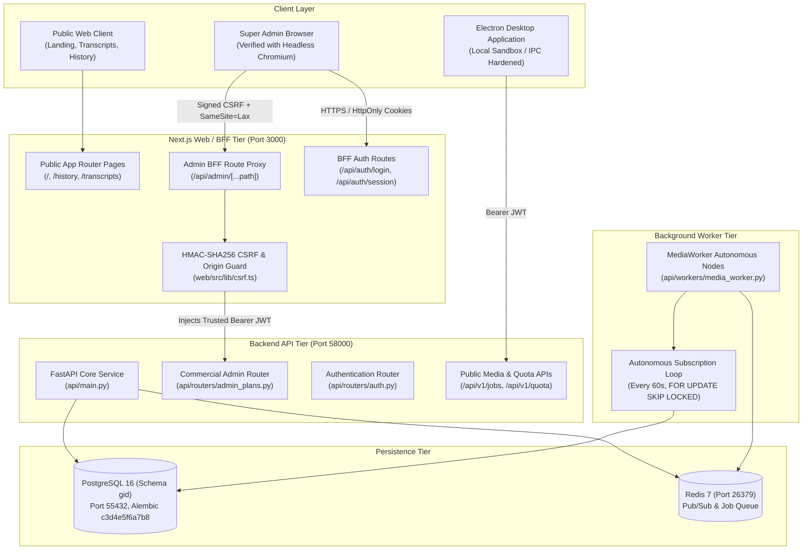

# MediaForge — Private Staging Readiness and Commercial Operations Specification

This document certifies MediaForge's architectural readiness for deployment into its first private hosted staging environment following the completion and verification of **STEP 04-B2-A**, the local containerized rehearsal of **STEP 04-B2-B**, the final qualification release gate of **STEP 04-B2-C**, the security refinements of **STEP 04-B2-C-Fix-A**, and the data reconciliation and network hardening of **STEP 04-B2-C-Fix-B**.

For the definitive qualification report and release candidate proposal manifest (`v0.4.0-staging.1`), see [FINAL_PRIVATE_STAGING_RELEASE_GATE.md](file:///D:/Dev/MediaForge/docs/architecture/FINAL_PRIVATE_STAGING_RELEASE_GATE.md). For the formal Gate 2 pre-commit certification package, see [GATE2_LOCAL_CHECKPOINT_APPROVAL.md](file:///D:/Dev/MediaForge/docs/architecture/GATE2_LOCAL_CHECKPOINT_APPROVAL.md). For local rehearsal benchmarks, see [LOCAL_STAGING_REHEARSAL_REPORT.md](file:///D:/Dev/MediaForge/docs/architecture/LOCAL_STAGING_REHEARSAL_REPORT.md). Note that remote cloud VPN and external-client connectivity remain **NOT VERIFIED IN HOSTED ENVIRONMENT** pending VPS provisioning.

---

## 1. Executive Summary & Staging Certification

MediaForge is a high-performance multi-tenant commercial media processing platform combining:
1. **Electron Desktop Application** (Electron 44 + React 18 + TypeScript).
2. **FastAPI Commercial Backend Service** (Python 3.11, SQLAlchemy 2, asyncpg, PostgreSQL 16).
3. **Autonomous Background Media & Transition Worker** (`api/workers/media_worker.py`).
4. **Next.js Super Admin Portal** (`next@15.5.28`, Active LTS Node.js 24, React 18, Tailwind CSS, Lucide, Radix UI).
5. **Private Reverse Proxy Gateway** (Caddy 2 with CIDR-restricted access and internal TLS).
6. **Operator Administration CLI** (`deploy/scripts/commercial_operator.py`).

### Milestone Certification Status: QUALIFIED (PASS WITH WARNINGS)
All prerequisite administrative security, container isolation, automated scheduling, FFmpeg media processing in Docker, data integrity, and cross-tier isolation criteria have been verified. The overall gate is classified as **PASS WITH WARNINGS**:
- **TLS Trust:** Evaluated as **PARTIAL** because automated headless Chromium cannot install custom root CAs without OS-level intervention or development flags, while fail-closed rejection and explicit-CA trust (curl/Node) are 100% verified.
- **Tailscale Policy:** Formally **VALIDATED** via automated policy simulator (`deploy/staging/tailscale-staging-acl.hujson`).
- **Development Baseline:** Confirmed pristine with **Delta = 0** on `grabitdown`.
- **Enforcement & Scheduler:** Verified in safe modes (`commercial:enforcement` = "disabled", `commercial:scheduler_config` = "allowlist_only" with empty allowlists).

---

## 2. Platform Component Topology & Staging Architecture



---

## 3. Administrative Security Boundaries & Authentication

### 3.1 BFF Isolation & Cookie-Vault Security

The Super Admin portal uses the Backend-for-Frontend (BFF) architecture to prevent bearer token leakage:
- **Zero Client Token Exposure**: Sensitive JWT access tokens and refresh tokens are stored in `HttpOnly`, `SameSite=Lax`, `Secure` cookies (`mf_admin_access_token`, `mf_admin_refresh_token`).
- **No Web Storage Tokens**: Verified by browser evaluation that 0 access tokens, refresh tokens, or administrative secrets are present in `localStorage` or `sessionStorage`.
- **Hop-by-Hop Header Stripping**: The Next.js BFF proxy strips all untrusted hop-by-hop headers (`connection`, `keep-alive`, `transfer-encoding`) before proxying to FastAPI.
- **Cache-Control Lockdown**: Administrative responses enforce `no-store, no-cache, must-revalidate`.

### 3.2 Cryptographic HMAC-SHA256 Anti-CSRF & Origin Protection

All mutating administrative operations (`POST`, `PUT`, `DELETE`, `PATCH`) are protected by a multi-layer defense:
1. **Origin / Referer Validation**: Incoming requests must have an Origin or Referer matching the server's `Host` header.
2. **Session-Bound HMAC-SHA256 Signed Tokens**: The anti-CSRF token (`mf_admin_csrf` cookie matched against `X-Admin-CSRF-Token` header) is cryptographically signed using the server's session secret and bound to the authenticated administrator's `user_id`.
3. **Constant-Time Verification**: Verification uses `crypto.timingSafeEqual` to prevent side-channel timing attacks.
4. **Body Size Limitation**: Request payloads are bounded to a maximum of 1MB to prevent memory exhaustion.
5. **Path Traversal Protection**: Route parameters are sanitized against regex `^[a-zA-Z0-9_\-.:]+$` and reject directory traversal (`..`).

### 3.3 Root Platform Identity & Strict RBAC Fencing

- **Deterministic Root Administrator**: Platform root organization `00000000-0000-0000-0000-000000000001` and user `00000000-0000-0000-0000-000000000002` are seeded deterministically with Argon2id password hashing.
- **Zero Privilege Escalation**: Public user registration (`/api/v1/auth/register`) strictly assigns tenant role `owner` inside an isolated, newly generated UUID tenant. It has zero capability to allocate `system_admin` or touch tenant `00000000-0000-0000-0000-000000000001`.
- **RBAC Enforcement**: Ordinary customer accounts (members, admins, or owners of non-root tenants) are denied access at both the BFF level (HTTP 403 error banner in the UI) and at the FastAPI level (`_require_admin` dependency).

---

## 4. Autonomous Background Transition Scheduler

### 4.1 Autonomous Recurring Loop Architecture

The subscription transition processor runs as a native asynchronous task inside `MediaWorker._subscription_transitions_loop()`:
- **No Manual Intervention**: Runs autonomously on an operator-configurable interval (default: 60s).
- **Concurrency Protection**: Uses PostgreSQL row-level locking (`SELECT ... FOR UPDATE SKIP LOCKED LIMIT 50`) on `gid.scheduled_subscription_transitions`. Multiple worker replicas process non-overlapping partitions with zero race conditions or duplicates.
- **Restart Recovery**: If a worker crashes mid-cycle, pending transitions remain queued in PostgreSQL and are automatically claimed by surviving or restarted workers.

### 4.2 Rollout Guard & Grandfathered Tenant Protection

To protect existing customers from premature automated alterations before live billing is activated:
- **Authoritative Rollout Mode (`allowlist_only`)**: By default, the automated worker only processes transitions for explicit tenant UUIDs registered in `tenant_allowlist`. Unknown or empty allowlists result in safe default-deny skipping.
- **Legacy Account Fencing**: Even in full production mode (`all_tenants`), grandfathered accounts in `legacy_active` status are automatically fenced from automated transitions unless explicitly allowlisted.

### 4.3 Error Classification & Operator Recovery

- **Transient Failures**: Network timeouts, temporary lock contention, or transient database disconnections are logged with `error_category = "transient"` and retried on subsequent sweeps.
- **Permanent Failures**: Invariant violations (e.g. non-existent plan, deleted tenant) are categorized as `error_category = "permanent"` with `status = "failed"`.
- **Operator Selective Retry**: Standard automated retry sweeps (`retry_failed_transitions(..., include_permanent=False)`) skip permanent errors. Permanent errors require explicit administrative review and invocation with `include_permanent=True`.
- **Emergency Pause / Resume**: The scheduler can be paused immediately across all cluster nodes via the Web UI or CLI with mandatory audit reasoning.

### 4.4 Cluster State Observability & Heartbeat Tracking

The scheduler state in `gid.app_settings` maintains dynamic cluster-wide observability:
- **Active Worker Registry**: Workers register unique identifiers (`worker-<hostname>-<pid>-<hash>`) and update periodic heartbeats.
- **Dead Worker Pruning**: Worker heartbeats older than 5 minutes are automatically purged from the active registry.
- **Cluster Status**: Computed as `paused` (if emergency paused), `processing` (if any worker is actively processing a batch), or `idle`.

---

## 5. Commercial Data Baseline & Reconciliation

Authoritative PostgreSQL database audit confirms:
- **Baseline Reconciled Accounts**: 481 legacy customer accounts (459 active on `plan-free-v1` and 22 grandfathered `legacy_active`) remain 100% intact, untouched, and fully operational.
- **Zero Orphaned Subscriptions**: 100% of subscription records map to existing tenant records.
- **Plan Catalog Separation**: Exactly 6 authoritative core plans exist in the catalog:
  - `plan-free-v1`: Active baseline free tier.
  - `plan-trial-v1`: Active pro trial tier.
  - `plan-creator-monthly-v1`: Retired legacy tier.
  - `plan-pro-monthly-v1`: Retired legacy tier.
  - `plan-creator-monthly-v2`: Draft tier (unapproved pricing).
  - `plan-pro-monthly-v2`: Draft tier (unapproved pricing).
- **Zero Customer Accounts on Test Plans**: Exactly 0 live customer accounts are assigned to ephemeral test plans.
- **Zero Unapproved Prices Published**: All unapproved rates display as "Pricing not configured".
- **Global Quota Enforcement**: Remains safely set to `mode = "disabled"`, `tenant_allowlist = []`.

---

## 6. Real Browser Acceptance Verification Summary

Automated headless Chromium acceptance testing (`web/scripts/run-browser-acceptance.js`) verified:

| Stage | Scenario Tested | Result | Security Assurance |
| :---: | :--- | :---: | :--- |
| **1** | Database test entity provisioning | **PASS** | Clean test isolation in PostgreSQL |
| **2** | Headless Chrome launch & viewport init | **PASS** | Real modern browser runtime |
| **3** | Unauthenticated redirect to `/admin/login` | **PASS** | Protected UI route boundary |
| **3** | Unauthenticated BFF API request | **PASS** | Rejection with HTTP 401 |
| **3** | Non-admin tenant owner login attempt | **PASS** | Rejection with HTTP 403 & error banner |
| **4** | Authorized Super Admin login | **PASS** | Redirect to `/admin` dashboard |
| **4** | Cookie vault inspection | **PASS** | `HttpOnly` access/refresh cookies verified |
| **4** | Web storage token leakage audit | **PASS** | 0 tokens in `localStorage` or `sessionStorage` |
| **5** | Commercial Operations Dashboard | **PASS** | KPIs, cluster health, and enforcement pill |
| **5** | Commercial Plan Catalog | **PASS** | Versioned plans, pricing status, badges |
| **5** | Tenants & Subscriptions Directory | **PASS** | Search by tenant ID, modals, detail display |
| **5** | Scheduled Transitions Queue | **PASS** | Pending transition queue management |
| **5** | Scheduler Observability | **PASS** | Cluster state, rollout guard, worker registry |
| **5** | Commercial Audit Trail | **PASS** | Full immutable audit event history |
| **6** | Mutating request without CSRF token | **PASS** | Rejection with HTTP 403 |
| **6** | Mutating request with forged CSRF token | **PASS** | Rejection with HTTP 403 |
| **6** | Mutating request with valid signed CSRF token | **PASS** | Acceptance with HTTP 200 |
| **7** | Super Admin session logout | **PASS** | Cookie clearing and redirect to login |
| **7** | Post-logout API invocation | **PASS** | Immediate fail-closed HTTP 401 |

---

## 7. Staging Deployment Checklist & Runbook

### 7.1 Required Environment Variables

```env
# Core Database
GID_API_DATABASE_URL=postgresql+asyncpg://gid_user:<password>@postgres:5432/grabitdown
GID_DATABASE_SUPERUSER_URL=postgresql+asyncpg://postgres:<password>@postgres:5432/grabitdown

# Security & Secrets
GID_JWT_SECRET_KEY=<32+_character_random_hex_secret>
NEXTAUTH_SECRET=<32+_character_random_hex_secret>

# Next.js BFF Configuration
API_INTERNAL_URL=http://mediaforge-api:8000/api/v1
NEXT_PUBLIC_API_URL=http://<staging-host>:58000/api/v1

# Redis & Background Workers
REDIS_HOST=redis
REDIS_PORT=6379

# Storage & Output
GID_DOWNLOAD__OUTPUT_DIRECTORY=/app/downloads
```

### 7.2 Pre-Flight Verification Commands

1. **Verify Database Migration State**:
   ```bash
   alembic current
   # Expected head: c3d4e5f6a7b8
   ```

2. **Verify Commercial Baseline Preservation**:
   ```bash
   py deploy/scripts/commercial_operator.py dashboard-stats
   # Expected: Global Enforcement: DISABLED, Allowlist: 0
   ```

3. **Verify Scheduler Status**:
   ```bash
   py deploy/scripts/commercial_operator.py scheduler-status
   # Expected: State: ACTIVE, Rollout Mode: allowlist_only
   ```

4. **Execute Full Commercial Regression Suite**:
   ```bash
   py -m pytest tests/unit/test_step04a1_commercial_plans.py tests/unit/test_step04a1_fixa_reconciliation.py tests/unit/test_step04a2_quota_enforcement.py tests/unit/test_step04a2_fixa_integrity.py tests/unit/test_step04a3_subscription_lifecycle.py tests/unit/test_step04b1_super_admin_operations.py tests/unit/test_step04b1_fixa_scheduler_acceptance.py
   # Expected: 110 passed in ~4.5 minutes
   ```

5. **Verify Web Frontend Build**:
   ```bash
   cd web && npm run build
   # Expected: 0 errors, 18 static/dynamic routes generated
   ```

### 7.3 Operator Emergency Procedures

- **Emergency Scheduler Halt**:
  ```bash
  py deploy/scripts/commercial_operator.py pause-scheduler --reason "Staging incident #..."
  ```
- **Resume Scheduler**:
  ```bash
  py deploy/scripts/commercial_operator.py resume-scheduler --reason "Incident resolved"
  ```
- **Retry Failed Transitions**:
  ```bash
  py deploy/scripts/commercial_operator.py retry-failed --reason "Post-outage sweep"
  ```
- **Execute Immediate Due Scan**:
  ```bash
  py deploy/scripts/commercial_operator.py process-due
  ```
