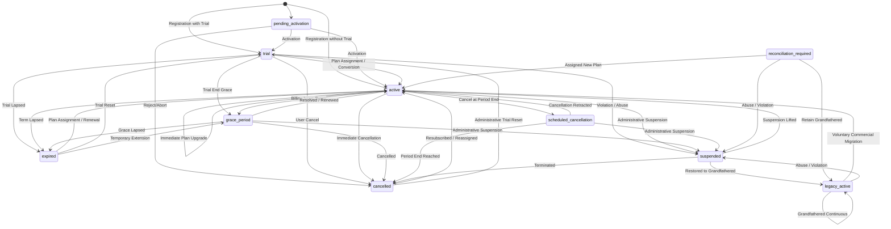

# MediaForge — Subscription Lifecycle, Commercial Administration and Scheduled Plan Transitions

This architectural document defines the production design, state machine, PostgreSQL data model, administrative APIs, and operator workflows for MediaForge commercial subscriptions, scheduled plan transitions, and trial/grace governance as finalized in **STEP 04-A3**.

---

## 1. Executive Summary & Design Principles

MediaForge is a multi-tenant commercial media engineering platform serving both desktop Electron clients and programmatic API integrations. The commercial platform separates **service access authorization** from **external payment settlement**, preventing phantom customer locks and maintaining zero disruption for existing customer accounts.

### Architectural Core Pillars

1. **State Separation**: Service-access state (active, restricted, blocked) is decoupled from payment verification status (`none`, `deferred`, `manual_grant`, `grandfathered`, `external_verified`).
2. **PostgreSQL-Backed Scheduling Authority**: Scheduled transitions (upgrades, downgrades, cancellations) reside in durable transactional PostgreSQL tables (`gid.scheduled_subscription_transitions`) with `FOR UPDATE SKIP LOCKED` concurrency protection.
3. **Immutability of Historical Plans**: Published commercial plans cannot be silently changed. Modifications require new plan versions.
4. **Existing Customer Preservation**: Reconciled accounts (459 free-tier and 22 grandfathered `legacy_active` accounts) maintain access without artificial blocks or forced migrations.
5. **Rollout Decoupling**: Global hard enforcement remains disabled (`mode = disabled`, `tenant_allowlist = []`) until commercial live billing is authorized.

---

## 2. Subscription Lifecycle State Machine

The subscription lifecycle governs access rights through 10 explicit states:



### Supported Lifecycle States

| State | Service Access | Quota Admission | Description |
| :--- | :--- | :--- | :--- |
| `pending_activation` | Blocked | Rejected (`SUBSCRIPTION_PENDING_ACTIVATION`) | Tenant account created but pending administrative or email verification. |
| `trial` | Granted | Evaluated against Trial Plan | Active trial period; expires at `trial_expires_at`. |
| `active` | Granted | Evaluated against Assigned Plan | Standard active commercial or free plan. |
| `grace_period` | Granted | Advisory Notice Active | Temporary access granted past scheduled expiration (1-90 days). |
| `scheduled_cancellation` | Granted | Evaluated against Assigned Plan | Access active until `current_period_end`, then cancelled. |
| `cancelled` | Restricted | Rejected / Fallback | Explicitly cancelled; future job admissions blocked. |
| `expired` | Restricted | Rejected (`TRIAL_EXPIRED`) | Trial or fixed-term period elapsed without renewal. |
| `suspended` | Blocked | Rejected (`SUBSCRIPTION_SUSPENDED`) | Administratively frozen; all operations blocked immediately. |
| `legacy_active` | Granted | Unlimited / Grandfathered | Pre-commercial historical tenant awaiting commercial review. |
| `reconciliation_required` | Flagged | Preserved / Advisory | Requires commercial administrative review. |

---

## 3. Service Access vs. Payment State Separation

> [!IMPORTANT]
> A customer account must never be marked `paid` without cryptographically authoritative payment gateway confirmation. In local and pre-production environments, all administrative grants are recorded as `manual_grant` or `none`.

```
Tenant Account
 ├── Service Access State:     [active | restricted | blocked]
 ├── Commercial Plan:          [plan_code, version, tier_type]
 ├── Subscription Lifecycle:   [trial, active, grace_period, suspended, etc.]
 ├── Payment Verification:     [none, deferred, manual_grant, grandfathered, external_verified]
 └── Enforcement Eligibility:  [allowed / shadow / enforce] (Feature-flag controlled)
```

1. **`none`**: Standard free-tier accounts (`plan-free-v1`).
2. **`deferred`**: Active trial accounts with zero billing obligations.
3. **`manual_grant`**: Privileged administrative grants, promotional accounts, and negotiated enterprise packages.
4. **`grandfathered`**: Legacy pre-commercial accounts (`legacy_active`).
5. **`external_verified`**: Reserved for future Stripe / Paddle / merchant webhook verifications.

---

## 4. Upgrade, Downgrade, and Transition Semantics

### Immediate Upgrades

- When a tenant upgrades to a higher tier (e.g. Free to Pro Trial, or Creator to Pro), changes take effect **immediately**.
- Existing reservations and running background jobs remain completely intact.
- Higher quota limits apply immediately to prospective operations.
- Subscription `current_period_start` resets to the transition timestamp, and `current_period_end` advances according to the new plan's billing interval (`monthly`, `annual`, `lifetime`).

### Scheduled Downgrades

- Downgrades reduce customer allowances. To protect customer contractual rights:
  1. By default, downgrades are **scheduled for `current_period_end`** (the billing boundary).
  2. The schedule is stored in `gid.scheduled_subscription_transitions` with `status = 'pending'`.
  3. Current plan allowances remain in force until the transition executes.
  4. Ongoing jobs are **never cancelled** when a downgrade executes.
  5. Stored customer media and artifacts are **never deleted**.
  6. Prospective jobs are evaluated against the new lower quotas only after the transition becomes effective.

### Immediate Downgrades (Emergency Override)

- If an operator explicitly authorizes an immediate downgrade, `assign_tenant_plan_lifecycle` executes immediately with a mandatory administrative reason logged in the audit trail.

---

## 5. PostgreSQL-Backed Scheduled Transition Engine

Scheduled transitions are executed via an idempotent PostgreSQL transaction engine:

```sql
-- Safe concurrency query avoiding deadlocks or double-executions:
SELECT * FROM gid.scheduled_subscription_transitions
WHERE status = 'pending' AND scheduled_at <= :now
FOR UPDATE SKIP LOCKED;
```

### Table Schema: `gid.scheduled_subscription_transitions`

```sql
CREATE TABLE gid.scheduled_subscription_transitions (
    id VARCHAR(36) PRIMARY KEY,
    tenant_id VARCHAR(36) NOT NULL REFERENCES gid.tenants(id) ON DELETE CASCADE,
    target_plan_id VARCHAR(36) REFERENCES gid.commercial_plans(id) ON DELETE RESTRICT,
    transition_type VARCHAR(32) NOT NULL,
    status VARCHAR(32) NOT NULL DEFAULT 'pending',
    scheduled_at TIMESTAMP WITHOUT TIME ZONE NOT NULL,
    executed_at TIMESTAMP WITHOUT TIME ZONE,
    reason TEXT NOT NULL,
    actor_user_id VARCHAR(36) REFERENCES gid.users(id) ON DELETE SET NULL,
    actor_role VARCHAR(64) NOT NULL DEFAULT 'system_admin',
    metadata_json JSON NOT NULL DEFAULT '{}',
    created_at TIMESTAMP WITHOUT TIME ZONE NOT NULL DEFAULT now(),
    updated_at TIMESTAMP WITHOUT TIME ZONE NOT NULL DEFAULT now(),
    CONSTRAINT ck_sched_trans_type CHECK (transition_type IN ('upgrade', 'downgrade', 'cancel', 'renewal')),
    CONSTRAINT ck_sched_trans_status CHECK (status IN ('pending', 'executed', 'cancelled', 'failed'))
);

CREATE INDEX ix_sched_transitions_tenant_status ON gid.scheduled_subscription_transitions (tenant_id, status);
CREATE INDEX ix_sched_transitions_due ON gid.scheduled_subscription_transitions (status, scheduled_at);
```

### Contradictory Transition Prevention

- A tenant may only have **one pending scheduled transition** at any given time.
- Attempting to schedule a second transition while one is pending returns `400 Bad Request` (`"A pending scheduled transition already exists for this tenant. Cancel it before scheduling a new transition."`).
- An existing pending transition can be cancelled via `DELETE /api/v1/admin/tenants/{tenant_id}/subscription/schedule/{transition_id}`.

---

## 6. Period Boundaries vs. Usage Reset Semantics

1. **Usage Metering Boundaries**: Consumption aggregation (`monthly_download_count`, `monthly_download_bytes`, `monthly_clip_seconds`, etc.) uses deterministic **UTC calendar-month bounds** (`YYYY-MM-01 00:00:00 UTC` to first of next month). Historical usage events are append-only and never deleted or mutated at month reset.
2. **Subscription Period Boundaries**: Subscriptions track `current_period_start` and `current_period_end` based on plan billing intervals (`monthly`, `annual`, `lifetime`).
3. **Administrative Renewal**: Advances `current_period_start` to previous `current_period_end` and recalculates `current_period_end`. Historical usage records remain intact.

---

## 7. Commercial Administration REST API

All commercial administration endpoints enforce strict system-admin authorization (`is_system_admin || is_system_owner`). Tenant admins or regular members receive `403 Forbidden`.

### Endpoints Matrix

| HTTP Method | Route | Description |
| :--- | :--- | :--- |
| `GET` | `/api/v1/admin/plans` | List plan catalog across all versions and statuses. |
| `POST` | `/api/v1/admin/plans` | Create a draft commercial plan. |
| `POST` | `/api/v1/admin/plans/{id}/publish` | Publish plan (requires approved pricing if paid tier). |
| `PUT` | `/api/v1/admin/plans/{id}/pricing` | Update pricing and approval status on draft plan. |
| `POST` | `/api/v1/admin/plans/{id}/retire` | Retire plan (no new subscribers; existing grandfathered). |
| `GET` | `/api/v1/admin/tenants/{id}/subscription` | Comprehensive tenant status, limits, and consumption. |
| `GET` | `/api/v1/admin/tenants/{id}/subscription/preview` | Preview plan change entitlement diff & pricing. |
| `POST` | `/api/v1/admin/tenants/{id}/subscription/assign` | Assign published plan immediately. |
| `POST` | `/api/v1/admin/tenants/{id}/subscription/schedule` | Schedule future plan upgrade, downgrade, or cancel. |
| `DELETE` | `/api/v1/admin/tenants/{id}/subscription/schedule/{tid}` | Cancel pending scheduled transition. |
| `GET` | `/api/v1/admin/tenants/{id}/subscription/transitions` | List scheduled transitions for tenant. |
| `POST` | `/api/v1/admin/plans/transitions/process-due` | Trigger execution of all due scheduled transitions. |
| `POST` | `/api/v1/admin/tenants/{id}/subscription/grace-period` | Enter grace period (1-90 days) with reason. |
| `POST` | `/api/v1/admin/tenants/{id}/subscription/exit-grace` | Exit grace period to active, cancelled, or expired. |
| `POST` | `/api/v1/admin/tenants/{id}/subscription/suspend` | Freeze subscription access immediately. |
| `POST` | `/api/v1/admin/tenants/{id}/subscription/unsuspend` | Lift suspension and restore prior status. |
| `POST` | `/api/v1/admin/tenants/{id}/subscription/cancel` | Cancel immediately or schedule for period end. |
| `POST` | `/api/v1/admin/tenants/{id}/subscription/renew` | Administratively advance period bounds. |
| `POST` | `/api/v1/admin/tenants/{id}/subscription/quote` | Generate quotation preview with approved prices. |
| `GET` | `/api/v1/admin/tenants/{id}/subscription/history` | Chronological transition and audit history. |
| `GET` | `/api/v1/admin/tenants/{id}/overrides` | List tenant-specific entitlement overrides. |
| `POST` | `/api/v1/admin/tenants/{id}/overrides` | Set explicit entitlement override. |
| `DELETE` | `/api/v1/admin/tenants/{id}/overrides/{key}` | Revoke entitlement override. |
| `GET` | `/api/v1/admin/audit-logs` | Query immutable commercial audit trail. |
| `GET` | `/api/v1/admin/settings/trial` | Retrieve persistent default trial duration setting. |
| `PUT` | `/api/v1/admin/settings/trial` | Update persistent default trial duration setting. |
| `GET` | `/api/v1/admin/settings/enforcement` | Retrieve rollout configuration (mode & allowlist). |
| `PUT` | `/api/v1/admin/settings/enforcement` | Update rollout configuration with audit reasoning. |

---

## 8. Web Admin UI Assessment & Operator CLI Workflow

### Architectural Review of `web/`

Inspection of the `web/` directory confirmed that it is currently a standalone Next.js client-side application without:
1. Server-side session verification or cookie handling.
2. User authentication routes (`/login`, `/auth/callback`).
3. Role-Based Access Control (RBAC) middleware.
4. Secure token storage for system-administrator JWT credentials.

Embedding privileged administration views into `web/` without secure authentication would expose high-privilege endpoints or require client-side credential spoofing.

**Resolution:**
- The Web UI status is formally marked **PARTIAL**.
- A production-grade operator CLI utility is provided at `deploy/scripts/commercial_operator.py` for server-authoritative command execution:

```powershell
# List commercial plan catalog
python deploy/scripts/commercial_operator.py list-plans

# Inspect tenant subscription status
python deploy/scripts/commercial_operator.py tenant-status <tenant_id>

# Preview plan change differences
python deploy/scripts/commercial_operator.py preview-change <tenant_id> <target_plan_id>

# Process due scheduled transitions
python deploy/scripts/commercial_operator.py process-due
```

---

## 9. Customer Visibility (Desktop Integration)

The Electron desktop application exposes read-only commercial visibility in `SettingsView.tsx`:

1. **Current Plan Badge**: Displays plan name, version, and formatted lifecycle status (`active`, `legacy active`, `trial`, `grace period`, `scheduled cancellation`, `suspended`).
2. **Scheduled Plan Change Banner**: Highlights target plan and effective date if a transition is pending.
3. **Grace Period Banner**: Displays remaining days before expiration.
4. **Suspension Banner**: Warns the customer if access is frozen, displaying the administrative reason.
5. **Read-Only Invariants**: No fake checkout flows, no unapproved pricing offers, and no fabricated payment indicators.

---

## 10. Database Migration Safety & Reversibility

Migration `c3d4e5f6a7b8_subscription_lifecycle_and_scheduled_transitions.py` adds the lifecycle check constraint and scheduled transition table:

1. **Zero Downtime Constraint Expansion**: Extends `ck_tenant_subscriptions_status` to include all 10 states.
2. **Table Creation**: Adds `gid.scheduled_subscription_transitions` with indexes on `(tenant_id, status)` and `(status, scheduled_at)`.
3. **Reversibility**: `downgrade()` cleanly drops the transitions table and restores the prior 6-state constraint.
4. **Pre-Migration Verification**: Validated on disposable database `grabitdown_mig_verify` prior to application on authoritative database. All 481 tenants and 6 commercial plans verified intact.
