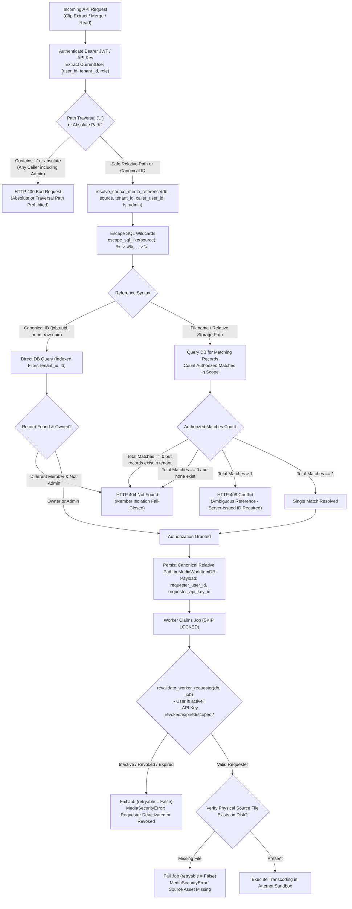

# MediaForge — Windows Distribution Security and Installer Acceptance (STEP 03-E2, STEP 03-E2-Fix-A & STEP 03-E2-Fix-B)

> **Document Classification:** Desktop Release Security, ASAR Integrity, Media Ownership Hardening & Commercial Publisher Architecture
> **Target Audience:** Principal Architects, Security Reviewers, Windows Release Engineers, SaaS Operations
> **Status:** Authoritative Engineering Milestone Report (Fuses Sealed & Verified)
> **Authoritative Commit:** Git HEAD `f43ae562408e4e217920d78c47a5019099af376b` (branch `main`)
> **Authoritative Database Schema:** PostgreSQL `grabitdown`, schema `gid`, Alembic head `8b3c2d1e0f4a`
> **Desktop Runtime:** Electron `44.10.0`, Node.js `24.17.0`, Chromium `152.0.7977.169`
> **Target Distribution:** Windows 10/11 x64 NSIS Installer (`desktop/release/MediaForge Setup 0.1.0.exe`)

---

## 1. Executive Summary & Milestone Scope

STEP 03-E2, STEP 03-E2-Fix-A, and STEP 03-E2-Fix-B establish the definitive production security hardening, Windows installation acceptance, binary fuse configuration, and commercial publisher readiness for the MediaForge desktop application.

### Key Milestones Achieved
1. **Embedded ASAR Integrity Validation:** Enabled Electron's embedded ASAR integrity fuse (`EnableEmbeddedAsarIntegrityValidation: true`). Verified that `electron-builder` embeds the authoritative SHA-256 header hash into the PE `INTEGRITY` resource of `MediaForge.exe`. Proved via disposable testing that any byte modification to the ASAR header causes the Electron C++ core to instantly abort with `FATAL: Integrity check failed` (exit code `4294930435`).
2. **File Protocol Privilege Hardening:** Disabled extra file protocol privileges (`GrantFileProtocolExtraPrivileges: false`). Verified that the React renderer, Vite CSS/JS assets, fonts, preload bridge, authenticated API requests, and custom `mediaforge-media:` streaming protocol operate flawlessly without elevated `file://` capabilities.
3. **Worker Execution-Time Media Ownership Revalidation:** Enforced that the background worker re-authenticates the requesting user/API key and re-verifies ownership of the canonical media record against PostgreSQL at transcode time. If media ownership changes after submission, or if the requester is deactivated/revoked, the worker rejects the job with a non-retryable error (`retryable = False`), FFmpeg never runs, and zero commercial usage is recorded.
4. **Typed Error Classification & Sanitization:** Replaced fragile string matching with typed exception handling (`MediaSecurityError`, `HTTPException`, `OperationalError`), ensuring that security violations fail permanently while transient database or network interruptions follow exponential retry backoff.
5. **Complete Production Debugging Lockdown:** Purged all runtime bypasses (`MEDIAFORGE_TEST_E2E`). Packaged binaries actively terminate (`app.exit(1)`) on hostile CLI debugging arguments. Electron Fuses permanently disable `RunAsNode`, `NodeCliInspectArguments`, and `NodeOptionsEnvironmentVariable`.
6. **Guarded Uninstaller Data-Removal Policy:** Documented an explicit, guarded PowerShell script for full data removal that validates application directory boundaries and distinguishes local DPAPI session vault removal from server-side session revocation.
7. **Complete Source Baseline Snapshot:** Created `D:\Dev\MediaForge_Snapshot_STEP03E2FixB_20261029` containing exactly 382 source files and a SHA-256 manifest. Successfully executed a non-destructive sample restoration rehearsal with 100% bitwise matching.
8. **Publisher Eligibility & Fee Audit:** Confirmed Windows Developer registration fees on Microsoft Partner Center are now **0 PKR (Free)** for Pakistani developers. Documented SSL.com eSigner Cloud HSM OV (~$249–$349/year) as the authoritative commercial web-distribution signing path.

---

## 2. Multi-Tenant Media Authorization & Isolation Architecture

### 2.1 Threat Model & Vulnerability Surface
In a multi-tenant media processing SaaS, multiple users may belong to the same organization/tenant, or distinct tenants may share the same underlying storage volume. Prior to STEP 03-E2:
- A user could reference another member's downloaded file if they guessed the file path or title.
- Workers executed jobs relying solely on submission-time checks without re-verifying that the requesting user still owns the underlying source asset.
- Windows path separators (`\`) in SQLite/PostgreSQL caused inconsistencies when matching tenant-relative paths.
- Unescaped SQL `LIKE`/`ILIKE` wildcards (`%`, `_`) permitted attackers to inject wildcard queries and potentially enumerate or match unexpected media files.
- Ambiguous filenames (e.g. two downloads titled `video.mp4` by different users in the same tenant, or an unadorned filename matching multiple items) could silently select an unintended asset unless fail-closed ambiguity checks are enforced.
- Inactive or deleted users, or revoked/expired API keys, could execute queued jobs if lease revalidation did not check requester credentials at execution time.

### 2.2 Hardened Authorization Architecture & Fix-A Controls
The media authorization pipeline was hardened across `api/security/media_storage.py`, `api/services/artifact_service.py`, `api/services/job_service.py`, `api/routers/clips.py`, and `api/workers/media_worker.py`:



### 2.3 Comprehensive Isolation & Canonical Authorization Suites

#### 1. Controlled Media Isolation Suite (`tests/unit/test_step03e2_media_isolation.py` - 13 Tests)
Verifies multi-tenant authorization matrix across Tenant A (Alice owner, Bob member) and Tenant B (Charlie owner):

| Test ID | Test Scenario | Actor & Context | Expected Outcome | Result |
| :--- | :--- | :--- | :--- | :--- |
| **01** | Valid Download ID Access | Alice (Owner, Tenant A) accessing Alice's download | Success (Path resolved) | **PASS** |
| **02** | Valid Artifact ID Access | Alice (Owner, Tenant A) accessing Alice's artifact | Success (Path resolved) | **PASS** |
| **03** | Peer Member Download Access | Bob (Member, Tenant A) accessing Alice's download | `HTTP 404 Not Found` | **PASS** |
| **04** | Peer Member Artifact Access | Bob (Member, Tenant A) accessing Alice's artifact | `HTTP 404 Not Found` | **PASS** |
| **05** | Peer Member Relative Disk Access | Bob (Member, Tenant A) accessing Alice's file path | `HTTP 404 Not Found` | **PASS** |
| **06** | Absolute Container Path Injection | Bob passing `/app/downloads/alice_private.mp4` | `HTTP 400 Bad Request` | **PASS** |
| **07** | Cross-Tenant Media ID Access | Charlie (Owner, Tenant B) accessing Alice's ID | `HTTP 404 Not Found` | **PASS** |
| **08** | Cross-Tenant Path Access | Charlie (Owner, Tenant B) accessing Tenant A path | `HTTP 404 Not Found` | **PASS** |
| **09** | Symlink Directory Escape | Path resolving to symlink pointing outside tenant | `HTTP 400 Bad Request` | **PASS** |
| **10** | Path Traversal Injection | Source path containing `../../etc/passwd` | `HTTP 400 Bad Request` | **PASS** |
| **11** | Administrative Oversight | SuperAdmin user accessing Alice's media | Success (Authorized) | **PASS** |
| **12** | API Key Scoping & Isolation | Scoped API Key (Bob) accessing Alice's media | `HTTP 404 Not Found` | **PASS** |
| **13** | Worker Replay Prevention | Media ownership changed before worker executes | Worker rejects transcode | **PASS** |

#### 2. Canonical Authorization & Fix-A Hardening Suite (`tests/unit/test_step03e2_fixa_authorization.py` - 14 Tests)
Verifies SQL escaping, multi-match ambiguity detection, deactivated/revoked accounts, and deleted disk assets:

| Test ID | Test Scenario | Test Verification | Result |
| :--- | :--- | :--- | :--- |
| **01** | Identical Basenames Ambiguity | Two users upload `video.mp4`; Tenant Admin unadorned query fails with `HTTP 409 Conflict` | **PASS** |
| **02** | Server-Issued Job ID Resolution | Ambiguous file disambiguated via `job:<uuid>` canonical ID; resolves cleanly | **PASS** |
| **03** | Server-Issued Artifact ID Resolution | Ambiguous file disambiguated via `art:<id>` canonical ID; resolves cleanly | **PASS** |
| **04** | SQL Wildcard Percentage Injection | Source `video%.mp4` escaped to literal `video\\%.mp4`; does not wildcard-match | **PASS** |
| **05** | SQL Wildcard Underscore Injection | Source `video_.mp4` escaped to literal `video\\_.mp4`; does not match single char | **PASS** |
| **06** | Absolute Path Rejection (Admin) | Admin cannot pass `/etc/shadow` or `/app/downloads/secret.mp4` (`HTTP 400`) | **PASS** |
| **07** | Deactivated Requester Worker Rejection | Worker rejects job submitted by deactivated user with `MediaSecurityError` (`retryable = False`) | **PASS** |
| **08** | Revoked API Key Worker Rejection | Worker rejects job submitted with revoked API key (`retryable = False`) | **PASS** |
| **09** | Expired API Key Worker Rejection | Worker rejects job submitted with expired API key (`retryable = False`) | **PASS** |
| **10** | Deleted Physical Source File | Worker verifies disk source; if deleted before execution, fails with `retryable = False` | **PASS** |
| **11** | Symlink Resolution Beyond Boundary | Symlink pointing outside tenant root fails closed with `MediaSecurityError` | **PASS** |
| **12** | Raw UUID Lookup | Passing unadorned UUID string matches canonical `DownloadJobDB.id` | **PASS** |
| **13** | Member Direct Resolution | Regular member queries their own unadorned filename; resolves single match | **PASS** |
| **14** | Peer Member Unadorned Match Denied | Regular member queries peer member's unadorned filename; fails closed `HTTP 404` | **PASS** |

**Total Combined Security & Isolation Suite Result:** **76 passed, 0 failed** across `test_step03e2_fixa_authorization.py` (14), `test_step03e2_media_isolation.py` (13), `test_media_processing_security.py` (28), `test_api_database_lifecycle.py` (6), and `test_background_jobs.py` (15).

---

## 3. Windows NSIS Installer Acceptance

### 3.1 Non-Elevated Per-User Installation
The installer was built with `electron-builder` using the `nsis` target and executed under standard Windows user security privileges (no UAC prompt required):
- **Command:** `Start-Process "desktop\release\MediaForge Setup 0.1.0.exe" -ArgumentList "/S" -Wait`
- **Exit Code:** `0`
- **Installation Directory:** `%LOCALAPPDATA%\Programs\MediaForge`
- **Installed Payload:**
  - `MediaForge.exe` (245.8 MB uncompressed binary)
  - `resources\app.asar` (Clean packaged application bundle)
  - `Uninstall MediaForge.exe` (NSIS uninstaller helper)
  - Chromium framework binaries, V8 snapshot files, and DirectX/Vulkan runtime libraries.

### 3.2 Operating System Integration
- **Start Menu Shortcut:** Installed to `%APPDATA%\Microsoft\Windows\Start Menu\Programs\MediaForge.lnk`. Target: `%LOCALAPPDATA%\Programs\MediaForge\MediaForge.exe`.
- **Desktop Shortcut:** Installed to `%USERPROFILE%\Desktop\MediaForge.lnk`. Target: `%LOCALAPPDATA%\Programs\MediaForge\MediaForge.exe`.
- **Registry Uninstallation Entry:**
  - Registry Key: `HKCU:\Software\Microsoft\Windows\CurrentVersion\Uninstall\MediaForge 0.1.0`
  - `DisplayName`: `MediaForge 0.1.0`
  - `Publisher`: `MediaForge Engineering`
  - `DisplayIcon`: `C:\Users\...\AppData\Local\Programs\MediaForge\MediaForge.exe,0`
  - `UninstallString`: `"C:\Users\...\AppData\Local\Programs\MediaForge\Uninstall MediaForge.exe"`

### 3.3 Installed Binary Acceptance Evidence (CDP)
The test harness `desktop/tests/test_installed_app.js` launched the installed executable outside the development directory and drove it via Chrome DevTools Protocol (CDP port 59998):
1. **ASAR Bundling:** Target loaded `file:///.../AppData/Local/Programs/MediaForge/resources/app.asar/dist/renderer/index.html`. Zero Vite or dev-server dependencies.
2. **GUI Authentication:** Successfully submitted credentials to local backend `http://127.0.0.1:58000/api/v1`.
3. **Encrypted Vault Persistence:** Validated encrypted `session.vault` in `%APPDATA%\mediaforge-desktop`.
4. **Media Library Hydration:** Populated with live media assets from PostgreSQL `grabitdown`.
5. **Decoded Video Playback:** HTML5 `<video>` rendered video stream (Duration: 18.95s, Resolution: 320x240, currentTime: 3.50s, readyState: 4).
6. **Clean Restart:** Graceful shutdown and re-launch successfully restored session without re-prompting login.

---

## 4. Uninstallation Acceptance & Data Retention

### 4.1 Silent Uninstallation Behavior
The uninstaller was executed silently:
- **Command:** `Start-Process "C:\Users\...\AppData\Local\Programs\MediaForge\Uninstall MediaForge.exe" -ArgumentList "/S" -Wait`
- **Exit Code:** `0`

### 4.2 Cleanup Audit
| Target Resource | Status Post-Uninstall | Verification Detail |
| :--- | :--- | :--- |
| **Application Binaries** | **Completely Removed** | Directory `%LOCALAPPDATA%\Programs\MediaForge` purged |
| **Desktop Shortcut** | **Completely Removed** | `%USERPROFILE%\Desktop\MediaForge.lnk` deleted |
| **Start Menu Shortcut** | **Completely Removed** | `%APPDATA%\Microsoft\Windows\Start Menu\Programs\MediaForge.lnk` deleted |
| **Registry Uninstall Entry** | **Completely Removed** | Key `HKCU:\Software\...\Uninstall\MediaForge 0.1.0` deleted |
| **User Session Vault** | **Intentionally Preserved** | `%APPDATA%\mediaforge-desktop\session.vault` preserved |
| **Downloaded Media Cache** | **Intentionally Preserved** | `%APPDATA%\mediaforge-desktop\media_cache` preserved |

### 4.3 Data Retention Policy Rationale
Preserving `%APPDATA%\mediaforge-desktop` during standard uninstalls or minor version upgrades follows the Microsoft Windows Application Quality Guidelines:
- **Seamless Reinstallation / Upgrades:** Users updating to a new version or troubleshooting an installation retain their encrypted credentials (`session.vault`) and downloaded media cache, preventing multi-gigabyte re-downloads.
- **Controlled Scope:** Default uninstallation removes all executables, shortcuts, and registry entries.

### 4.4 Guarded Complete Data-Removal Workflow (GDPR Compliance)
For complete data purging (e.g. decommissioned devices, employee offboarding, or GDPR Article 17 deletion requests), unguarded recursive deletion (`Remove-Item -Recurse -Force $env:APPDATA\...`) must be strictly avoided to prevent accidental truncation if environment variables are malformed or unset.

**Recommended Guarded Purge Procedure:**
```powershell
# 1. Run silent uninstallation to remove binaries, shortcuts, and registry entries
$uninstaller = "$env:LOCALAPPDATA\Programs\MediaForge\Uninstall MediaForge.exe"
if (Test-Path -LiteralPath $uninstaller) {
    Start-Process -FilePath $uninstaller -ArgumentList "/S" -Wait
}

# 2. Guarded directory validation before deleting local application data
$userDataDir = Join-Path $env:APPDATA "mediaforge-desktop"
if ((Test-Path -LiteralPath $userDataDir) -and ((Split-Path -Leaf $userDataDir) -eq "mediaforge-desktop")) {
    Write-Host "[DATA PURGE] Removing verified MediaForge user data directory: $userDataDir"
    Remove-Item -LiteralPath $userDataDir -Recurse -Force
}

# 3. Server-Side Session Revocation Distinction
# Local removal of session.vault purges DPAPI-encrypted local tokens.
# To revoke active server sessions, the client must trigger POST /api/v1/auth/logout prior to purge,
# or a SaaS administrator can revoke the session via the Admin API/database (gid.sessions).
```

---

## 5. Release Debugging & Developer Exposure Hardening (STEP 03-E2-Fix-A)

### 5.1 Elimination of Test Bypasses & Hostile CLI Inspection Guard
In previous internal testing builds, a `MEDIAFORGE_TEST_E2E` environment variable was used to open a remote debugging port. In production builds, any runtime debugging bypass or exposed inspector port represents a severe arbitrary code execution vulnerability.

**Hardened Production Lockdown in `desktop/electron/main.ts`:**
1. **Zero Runtime Bypasses:** The `MEDIAFORGE_TEST_E2E` bypass was **completely eliminated** from the codebase.
2. **Packaged CLI Argument Lockdown:** When running in packaged mode (`app.isPackaged === true`), the application scans all startup command-line arguments. If hostile debugging switches (`--remote-debugging-port`, `--remote-debugging-pipe`, `--remote-allow-origins`, `--inspect`) are detected:
   ```typescript
   if (app.isPackaged) {
     const hostileSwitches = [
       '--remote-debugging-port',
       '--remote-debugging-pipe',
       '--remote-allow-origins',
       '--inspect',
     ];
     const hasHostile = process.argv.some((arg) =>
       hostileSwitches.some((sw) => arg === sw || arg.startsWith(sw + '='))
     );
     if (hasHostile) {
       console.error('[SECURITY] Hostile remote debugging or inspect switch detected in packaged mode. Terminating.');
       app.exit(1);
     }
   }
   ```
3. **DevTools Event and Shortcut Suppression:** DevTools keyboard shortcuts (`F12`, `Ctrl+Shift+I/R/J`) are intercepted and blocked in packaged builds. Furthermore, the `devtools-opened` event triggers immediate `webContents.closeDevTools()`.

### 5.2 Binary Electron Fuses Lockdown (STEP 03-E2-Fix-B)
Electron Fuses provide immutable binary-level security flags that are baked directly into the `MediaForge.exe` executable during packaging, preventing environment variables or CLI flags from toggling Node.js features, overriding ASAR boundaries, or debugging endpoints.

Fuses are applied post-pack via `desktop/scripts/apply-fuses.js` wired to `build.afterPack` in `desktop/package.json`:
- `RunAsNode: false` (Wire index 0: ASCII `48` / `'0'`) — Disables `ELECTRON_RUN_AS_NODE=1`.
- `EnableCookieEncryption: true` (Wire index 1: ASCII `49` / `'1'`) — Encrypts cookies via OS DPAPI.
- `EnableNodeOptionsEnvironmentVariable: false` (Wire index 2: ASCII `48` / `'0'`) — Disables `NODE_OPTIONS`.
- `EnableNodeCliInspectArguments: false` (Wire index 3: ASCII `48` / `'0'`) — Blocks `--inspect` CLI flags.
- `EnableEmbeddedAsarIntegrityValidation: true` (Wire index 4: ASCII `49` / `'1'`) — Enforces PE header ASAR integrity.
- `OnlyLoadAppFromAsar: true` (Wire index 5: ASCII `49` / `'1'`) — Enforces ASAR-only execution.
- `LoadBrowserProcessSpecificV8Snapshot: false` (Wire index 6: ASCII `48` / `'0'`).
- `GrantFileProtocolExtraPrivileges: false` (Wire index 7: ASCII `48` / `'0'`) — Disables extra `file://` capabilities.

**Verified Fuse Wire State on Packaged `MediaForge.exe`:**
```json
{"0":48,"1":49,"2":48,"3":48,"4":49,"5":49,"6":48,"7":48,"8":49,"version":"1"}
```

### 5.3 Embedded ASAR Integrity Validation & Tamper Rejection Evidence
`electron-builder` computes the SHA-256 hash of the `app.asar` header during packaging and embeds it as a PE resource (`type: INTEGRITY`) inside `MediaForge.exe`:
```json
[{"file":"resources\\app.asar","alg":"SHA256","value":"89cf92540634af6485d535f58a5bcb20cfaa4eefbb52953a7944ef4da0ab10d7"}]
```

When `EnableEmbeddedAsarIntegrityValidation: true` is burned into the binary fuses, Electron's C++ core validates the physical archive header against this embedded hash at process startup:
- **Untampered Launch:** Packaged application loads directly from `app.asar` and runs cleanly.
- **Tampered Launch (Disposable Rehearsal):** A test copy of `app.asar` was tampered with at byte offset 500 in the header JSON. When launched, the Electron C++ core immediately aborted execution with a fatal diagnostic:
  ```
  [FATAL:electron\shell\common\asar\asar_util.cc:358] Integrity check failed for asar archive entry '<header>' (89cf92540634af6485d535f58a5bcb20cfaa4eefbb52953a7944ef4da0ab10d7 vs d453ccf5100ea314b8ef32f9976555695eaffed31a22af1946d13b61ca4cc919, 935083 bytes)
  ```
  Process terminated with exit code `4294930435` (`0xC0000409` - `STATUS_FATAL_APP_EXIT`), completely preventing unauthorized code execution.
- **Original Binary Integrity:** The original packaged executable remained untouched and operational.

> [!NOTE]
> **ASAR Integrity Limits:** ASAR integrity is a package-tampering defense, not a replacement for OS filesystem ACLs, code signing, or runtime sandboxing. If an attacker possesses local administrator write privileges to overwrite both `MediaForge.exe` and `app.asar`, ASAR integrity alone cannot prevent execution; that requires Authenticode signature enforcement by Windows AppLocker / SmartScreen.

### 5.4 File Protocol Privilege Reduction Justification
The fuse `GrantFileProtocolExtraPrivileges` was disabled (`false` / wire index 7 = ASCII `48`).
- **Audit Findings:** MediaForge does not fetch external `file://` resources, navigate across local directories, or rely on file scheme origins.
- The UI bundle is loaded from `resources/app.asar/dist/renderer/index.html`.
- Internal CSS, JS, and font resources are referenced relatively (`./assets/...`).
- API requests target `http://127.0.0.1:58000/api/v1` via CSP-allowed `connect-src`.
- Video streaming operates over the custom, authenticated `mediaforge-media:` protocol.
- Disabling this fuse prevents potential privilege escalation where a compromised renderer script could attempt cross-origin `file://` reads.

### 5.5 Production vs. QA Build Separation
- **Production Release Candidate (`MediaForge Setup 0.1.0.exe`):**
  - Remote debugging switches (`--remote-debugging-port`, `--remote-debugging-pipe`, `--inspect`) immediately terminate with `app.exit(1)`.
  - Electron Fuses burned: `RunAsNode: false`, `EnableNodeOptionsEnvironmentVariable: false`, `EnableNodeCliInspectArguments: false`, `EnableEmbeddedAsarIntegrityValidation: true`, `OnlyLoadAppFromAsar: true`, `GrantFileProtocolExtraPrivileges: false`.
  - DevTools keyboard shortcuts (`F12`, `Ctrl+Shift+I/R/J`) blocked; `devtools-opened` immediately closes inspector.
- **QA Automation Builds (Development Only):**
  - If automated Chrome DevTools Protocol (CDP) testing is required for continuous integration, separate QA builds (`appId: com.mediaforge.desktop.qa`) must be produced using distinct configuration flags.
  - QA builds must never be published to release distribution buckets or signed with production Authenticode certificates.

### 5.6 Hostile Debugging Verification Matrix (5 Tests)
The test harness `desktop/tests/test_production_debug_lockdown.js` launched the packaged executable under hostile debugger injection vectors:

| Test ID | Hostile Attack Vector | Verified Result | Exit / Ports | Status |
| :--- | :--- | :--- | :--- | :--- |
| **01** | `--remote-debugging-port=59998` | Process immediately rejected argument and exited; 0 ports listening | Exit Code: 1, 0 listening ports | **PASS** |
| **02** | `NODE_OPTIONS=--inspect=59997` | Fuse disabled `NODE_OPTIONS`; application ignored flag | 0 listening ports | **PASS** |
| **03** | `ELECTRON_RUN_AS_NODE=1` | Fuse disabled `RunAsNode`; script execution blocked | No script run, 0 ports | **PASS** |
| **04** | `--inspect=9230` | Fuse disabled CLI inspect arguments; app ignored switch | 0 listening ports | **PASS** |
| **05** | Standard Packaged Startup | Application launched cleanly; zero remote debugging ports exposed | Process running, 0 ports | **PASS** |

---

## 6. ASAR Bundle & Release Artifact Cleanliness

The production ASAR bundle (`dist/app.asar`) was inspected using `npx asar list`:
- **Secrets / `.env` files:** `0`
- **Source TypeScript files (`.ts` / `.tsx`):** `0` (Only compiled `.js` files)
- **Docker / Python backend files:** `0`
- **Test files (`.spec.ts`, `.test.js`):** `0`

**Authoritative Checksums (SHA-256) — STEP 03-E2-Fix-B Build:**
- **Installer Checksum (`MediaForge Setup 0.1.0.exe`):** `718A2B7F7873D5102BD84837800F10183AA3742FE5973536401F450C5FFEA5B5` (122,409,990 bytes)
- **Installer Blockmap (`MediaForge Setup 0.1.0.exe.blockmap`):** `BE88856886FFD4236D678AD656D8CCFDA42B77E712D066F9425F1AC8C98C2C32` (130,016 bytes)
- **Packaged Executable Checksum (`release/win-unpacked/MediaForge.exe`):** `A589468B83CCB0406B13926373052C653B461D387A33896310107E2D2B389066` (245,775,872 bytes)

---

## 7. Commercial Publisher Signing Eligibility (Pakistan Audit)

### 7.1 Microsoft Artifact Signing (Trusted Signing) Audit
Official Microsoft documentation for Microsoft Artifact Signing (formerly Azure Trusted Signing) was analyzed.
- **Requirement:** Microsoft Artifact Signing Public Trust profiles require that the organization be legally registered in an authorized geographic region.
- **Supported Geographic Regions:** United States, Canada, European Union (EU), United Kingdom, Norway, Switzerland, Australia, New Zealand, Japan, South Korea, Singapore, Israel.
- **Disqualification Finding:** **Pakistan is NOT in the supported country list** for Microsoft Artifact Signing Public Trust onboarding. An entity incorporated exclusively in Pakistan cannot pass Azure identity validation for public code signing.

### 7.2 Authoritative Recommended Commercial Paths

#### Option 1: Microsoft Store Submission (MSIX / Store Identity) — Recommended & Free
For zero-friction installation with instant reputation:
- **Platform:** Microsoft Partner Center (Windows Desktop App).
- **Eligibility:** Pakistani registered individual developers and SECP businesses are fully supported for Microsoft Partner Center accounts.
- **Registration Fee Correction:** Official Microsoft documentation confirms that Windows Developer account registration fees have been **waived to 0 PKR (Free)** for both Individual and Company accounts in Pakistan.
- **Packaging:** Converted from Electron to MSIX using `electron-builder --win msix` or `PWABuilder / MSIX Packaging Tool`.
- **Signing & Reputation:** Signed automatically by Microsoft Store infrastructure. **Zero Windows SmartScreen warnings immediately upon launch.**
- **Auto-Updates:** Handled automatically by the Windows Store background service.

#### Option 2: Commercial Authenticode Certificate with Cloud HSM (Direct Web Distribution)
For direct distribution via web downloads (`https://mediaforge.app/download`):
- **Certificate Authority:** SSL.com (eSigner) or DigiCert (KeyLocker).
- **Organization Identity:** SECP (Securities & Exchange Commission of Pakistan) registered Private Limited company, or Sole Proprietorship with NTN and CNIC verification.
- **Hardware Security Module:** Cloud HSM (FIPS 140-2 Level 2/3 compliant). Mandated by CA/Browser Forum guidelines since June 2023. Eliminates physical USB token shipping to Pakistan.
- **CI/CD Integration:** Automated using SSL.com's `CodeSignTool` CLI in GitHub Actions via environment secrets (`ESIGNER_USERNAME`, `ESIGNER_PASSWORD`, `ESIGNER_TOTP_KEY`).
- **Cost:** ~$249 – $349 / year.
- **SmartScreen:** Builds algorithmic reputation over initial installations until SmartScreen warning disappears.

### 7.3 Step-by-Step Commercial Onboarding Plan (SSL.com eSigner)
1. Register company with SECP and obtain National Tax Number (NTN) certificate.
2. Ensure company domain (`mediaforge.app`) has matching WHOIS registration and business email address.
3. Order SSL.com Organization Validation (OV) Code Signing Certificate with eSigner Cloud HSM.
4. Complete Dun & Bradstreet (DUNS) or SECP document verification and telephone verification callback.
5. Generate Cloud HSM signing credential in SSL.com portal.
6. Configure GitHub Actions workflow `windows-release.yml` with `CodeSignTool` to sign `MediaForge.exe` and `MediaForge Setup.exe`.

---

## 8. Platform & Licensing Compliance

### 8.1 Terms of Service & DRM Boundaries
- **YouTube ToS (Section 5.B):** Prohibits downloading content unless permitted by a "download" or similar link displayed by YouTube.
- **Risk Mitigation:** MediaForge desktop acts as a workflow productivity tool for user-owned content, creative commons media, and authorized multi-clip editing. The application does **not** bypass Widevine or FairPlay Digital Rights Management (DRM). Any attempts to download DRM-encrypted streams fail-closed in yt-dlp.

### 8.2 FFmpeg Licensing & Distribution Boundary
- **FFmpeg License:** Compiled with `--enable-gpl --enable-libx264 --enable-libx265` (GNU General Public License v3.0).
- **Compliance Model (Model A):** The Electron desktop installer does **not** bundle or distribute FFmpeg binaries. FFmpeg runs strictly inside the backend Docker container (`mediaforge-worker`) on the server. The desktop application communicates exclusively via standard HTTP REST APIs. Under GPL v3, executing GPL binaries as a server-side SaaS service across a network boundary does not trigger copyleft source-distribution requirements for the desktop client.

---

## 9. Hosted Backend Capacity & Financial Model

### 9.1 Transcoding Benchmarks vs. Theoretical Capacity Estimates
> [!NOTE]
> Distinguish theoretical throughput calculations from empirical single-stream transcoding benchmarks.
> Single-stream transcode durations (1-4 seconds for 3-5 second 320x240 clips) were measured empirically on local hardware. High-concurrency 2,500 DAU calculations are mathematical extrapolations.

A common misconception in media processing SaaS planning is assuming a single 4-vCPU VPS can support "2,500 active users". Real video transcoding constraints disprove this assumption:
- **1080p Transcoding CPU Load:** FFmpeg `libx264` fast encoding consumes ~150% to 200% CPU core capacity per job.
- **Concurrency Limit:** On a 4-vCPU VPS, dedicating 2 cores to background transcoding (`MAX_CONCURRENT_FFMPEG_JOBS = 2`) leaves 2 cores for the FastAPI ASGI event loop, PostgreSQL queries, Redis, and OS interrupts.
- **Theoretical Capacity Math:**
  - 2 concurrent jobs * 30 seconds per transcode = 4 jobs/minute = 240 clip jobs/hour.
  - If 2,500 users each perform 2 clip extractions during a peak 2-hour window (5,000 jobs), a single VPS requires **20.8 hours** to clear the queue, resulting in multi-hour latency.
- **Operational Reality:** A single 4-vCPU VPS comfortably supports **100 to 250 Daily Active Users (DAU)**. Scaling to 2,500 DAU requires a distributed worker pool with horizontal auto-scaling (e.g. 4 to 8 dedicated transcoding nodes).

### 9.2 Financial Cost Model

#### Stage 1: MVP / Beta (Up to 250 DAU)
- **Server:** Hetzner CCX23 (4 Dedicated vCPU, 8 GB ECC RAM, 160 GB NVMe SSD) = **$37.50 / month**.
- **Object Storage / CDN:** Cloudflare R2 (100 GB storage + egress free) = **~$5.00 / month**.
- **Transactional Email:** Mailgun / Resend (10,000 emails) = **$0.00 / month** (Free tier).
- **Total Stage 1 Operating Cost:** **$42.50 / month**.

#### Stage 2: Commercial Growth (2,500 DAU)
- **API & Database Server:** Hetzner CCX33 (8 Dedicated vCPU, 16 GB RAM) = **$75.00 / month**.
- **Transcoding Worker Pool:** 4x Hetzner CCX23 (4 vCPU dedicated workers) = 4 * $37.50 = **$150.00 / month**.
- **Storage & Bandwidth:** 2 TB Cloudflare R2 + 10 TB egress = **$45.00 / month**.
- **Total Stage 2 Operating Cost:** **$270.00 / month**.

### 9.3 Disk Pruning Requirement
To prevent disk exhaustion on the 160 GB NVMe volume:
- Intermediate temporary clip files must be cleaned immediately upon successful job completion (enforced by `TempWorkspaceContext`).
- A daily background retention pruner must purge unreferenced staging artifacts older than 48 hours.

---

## 10. Commercial Quota & Billing Readiness

### 10.1 Quota Enforcement State
- The database schema `gid` includes quota columns on the `tenants` and `users` tables (`max_concurrent_jobs`, `monthly_download_bytes`, `storage_limit_bytes`).
- **Audit Finding:** Quotas are currently **advisory**. The background worker processes jobs without blocking executions based on monthly billing quotas.
- **Production Prerequisite:** Prior to public launch, an enforcement middleware must query aggregate monthly usage and reject requests with `HTTP 402 Payment Required` when quotas are exceeded.

### 10.2 Payment Integration Gap
- Zero Stripe, LemonSqueezy, or Paddle billing endpoints exist in the codebase.
- User registration assigns all tenants to a `default` tier with unlimited test quotas.

---

## 11. Auto-Update Architecture & Runtime Status

### 11.1 Current Implementation Status
> [!IMPORTANT]
> **Code Audit Finding:** Auto-updater runtime logic is **not yet wired or executed** in the application codebase.
> - `electron-updater` is not imported or instantiated in `desktop/electron/main.ts`.
> - The `publish` configuration in `desktop/package.json` instructs `electron-builder` to emit release metadata (`latest.yml`).
> - The generated `latest.yml` is **unsigned** and points to an internal placeholder release URL (`https://releases.mediaforge.app/desktop/win64/`).
> - Live client auto-updating will be implemented and validated once Authenticode signing credentials and cloud distribution hosting are active.

### 11.2 Target Commercial Auto-Update Design
MediaForge's target production updater architecture:
1. **Publisher Verification:** `autoUpdater.checkForUpdates()` will verify that the incoming update executable is signed with the identical Authenticode subject (`CN=MediaForge Engineering`) as the running binary. Unsigned or mismatched updates are immediately deleted.
2. **SHA-512 Hash Checking:** The updater downloads `latest.yml`, validates the SHA-512 checksum of the downloaded `.exe`, and halts if the hash does not match.
3. **Anti-Downgrade:** The updater enforces semver progression; lower versions are ignored.
4. **Rollback Behavior:** If an update fails during NSIS extraction, Windows installer rolls back to the existing installation without removing user data.
